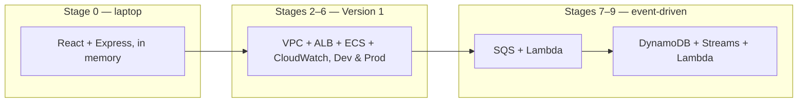

# AWS Workshop — from zero to event-driven

The main tutorial. You start with a running app on your laptop and finish with
a two-environment, load-balanced, observable, event-driven system on AWS —
configuring, deploying, breaking, and debugging every layer yourself.

**The promise: you never write application code.** The task app exists,
finished, in four versions. Your work is AWS: networking, IAM, containers,
load balancing, observability, queues, databases. When something breaks
(sometimes because you broke it on purpose), you debug it with the same tools
you'd use at 3am in production.

Before Stage 0, read [prerequisites.md](../prerequisites.md) (tools, account,
cost guardrails, naming conventions) — and set up the $5 billing alarm in
Stage 1 **before** creating billable resources.

## The learning path

| Stage | Title | App version | New AWS concepts | Est. time |
|---|---|---|---|---|
| 0 | [Run the app locally](stage-00-local-baseline.md) | v1 | request flow, environments | ~1 h |
| 1 | [Account, IAM, and the AWS CLI](stage-01-account-iam-cli.md) | – | accounts, regions, ARNs, IAM, policies vs roles, least privilege, cost guardrails | 1–2 h |
| 2 | [The Dev VPC](stage-02-dev-vpc.md) | – | VPC, CIDR, subnets, AZs, IGW, route tables, NAT | 3–4 h |
| 3 | [ECR → ECS task → ECS service](stage-03-ecr-ecs.md) | v1 | Docker images, ECR, clusters, task definitions, Fargate, ENIs | 3–4 h |
| 4 | [ALB, security groups, frontend](stage-04-alb-security-groups-frontend.md) | v1 | ALB, listeners, target groups, SG references | 2–3 h |
| 5 | [Prod VPC and isolation](stage-05-prod-vpc-isolation.md) | v1 | environment isolation, naming, **parking** | 2–3 h |
| 6 | [CloudWatch](stage-06-cloudwatch.md) | v1 | log groups/streams, retention, metrics, alarms | ~2 h |
| 7 | [SQS + Lambda](stage-07-sqs-lambda.md) | **v2** | queues, DLQs, execution roles, visibility timeout, event source mappings | 2–3 h |
| 8 | [DynamoDB](stage-08-dynamodb.md) | **v3** | tables, partition keys, task roles, managed services | ~2 h |
| 9 | [DynamoDB Streams](stage-09-dynamodb-streams.md) | **v4** | change data capture, at-least-once, idempotency | ~3 h |

Big picture — the same app evolves; the infrastructure gets richer:

## How each stage works

Every stage follows the same shape:

1. **Learning objectives** — what you'll be able to do afterwards.
2. **New AWS concepts** — a stage never introduces more than ~6.
3. **Architecture diagram** — what you're building, before and after.
4. **What you will build and why** — WHAT and WHY. Not button-by-button
   walkthroughs, not copy-paste command dumps: you are expected to read AWS
   documentation, use `--help`, and inspect resources. That friction is the
   curriculum. (Verification snippets do name the exact CLI commands to *read*
   state — reading is not spoon-feeding.)
5. **Verification** — prove it works, mostly with the CLI.
6. **Checkpoint** — *You should now have / Verify / You should be able to
   explain / Break it / Debug it / Cost check*.
7. **What changed from the previous stage.**

### On breaking things on purpose

Every stage's **Break it** asks you to sabotage your own infrastructure and
diagnose the wreckage. Symptoms and investigation questions live in the stage
file; the diagnosis-and-fix write-ups live in
[troubleshooting-solutions.md](../troubleshooting-solutions.md) — consult it
*after* forming your own theory. Debugging production systems is the actual
skill this workshop teaches; everything else is scaffolding for it.

### On cost

The design target is **$100 of credits, ~1 month** — every stage ends with a
**Cost check** line, and the architecture itself (1 NAT per VPC, Prod parking)
is shaped by that budget. Details: [cost-estimates.md](../cost-estimates.md).

### On the CLI

The CLI is used throughout — for creating, and especially for *inspecting*.
By Stage 9 you will have used `aws sts`, `ec2`, `ecs`, `ecr`, `elbv2`,
`cloudwatch`, `logs`, `iam`, `sqs`, `lambda`, and `dynamodb`. The goal is not
memorizing flags; it is internalizing that the Console and the CLI are two
views of the same APIs, and the scriptable one is the one that scales to real
work.

### On environments

One account, two environments, isolated at the network layer: **Dev**
(`10.10.0.0/16`) and **Prod** (`10.20.0.0/16`). Isolation via infrastructure,
not environment variables, is a recurring theme — Stage 5 makes you prove it.