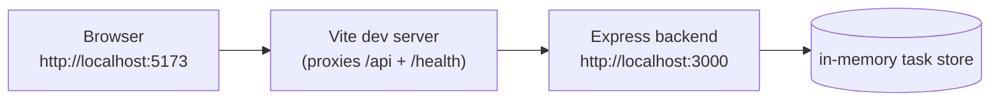

# Stage 0 — Run the app locally

> Stage 1 of 10 · no AWS yet · app version **v1** · ~1 hour

## Learning objectives

- Run the task app (React frontend + Node/Express backend) on your laptop.
- Read the API contract and drive it by hand with `curl` (the browser is
  optional).
- Explain what the `ENVIRONMENT` concept is for and where it will show up in AWS.
- Trace one request from the browser through the Vite dev proxy to the backend —
  and predict what replaces the proxy in AWS.

## New concepts (pre-AWS)

- **API contract**: the fixed set of endpoints and shapes both sides agree on.
- **Environment flag**: same code, different `ENVIRONMENT` — "dev" on your
  laptop, "dev"/"prod" on AWS later. Never hardcoded, always injected.
- **Relative URLs + a forwarding hop**: the frontend never knows *where* the
  backend is.

## Architecture

In Stage 4 the Vite proxy is replaced by an **Application Load Balancer** doing
the same job: one origin, two targets, `/api/*` goes to the backend. Remember
that when you break the proxy below.

## What you will build (and why)

Nothing in AWS yet — your job is to reach a **known-good baseline**.

### 1. Run the backend (versions/v1/backend)

Install and start it with an explicit environment:

- dependencies: npm install
- start in dev mode with `ENVIRONMENT=dev` (the scripts are `dev`, `build`,
  `start`, `test` — read `package.json`).
- If you forget `ENVIRONMENT`, the app **refuses to start** — read the error;
  this fail-fast behavior is deliberate and will matter in Stage 6.

### 2. Read the API contract, then drive it with curl

The backend exposes exactly:

| Endpoint | Purpose | Notes |
|---|---|---|
| `GET /health` | liveness | `{"status":"ok","environment":"dev"}` — later the ALB's health check target |
| `GET /api/environment` | which env am I talking to | feeds the frontend header |
| `GET /api/tasks` | list tasks | `[]` to start |
| `POST /api/tasks` `{"title":"..."}` | create | 201 + the created task |
| `PATCH /api/tasks/:id` `{"completed":true}` | mark complete | 404 for unknown id |

Exercise every row with `curl`, including the sad paths: empty title, unknown
id, garbage JSON. Watch the terminal — the backend logs **one JSON object per
line** for every request (method, path, status, duration, requestId). Those
exact lines are what you'll be grepping in CloudWatch in Stage 6.

Notice: tasks are stored **in memory**. Restart the backend and they're gone.
That is deliberate — v3 fixes it, and you should feel the difference when it
does.

### 3. Run the frontend (versions/v1/frontend)

Start the dev server, open `http://localhost:5173`:

- The header reads `Environment: dev` — that came from `GET /api/environment`
  *through the backend*, not from anything the frontend knows.
- Create a task, complete a task, and find the corresponding request log line
  in the backend's terminal.
- Open devtools → Network: note that the browser only ever talks to
  `localhost:5173`. `/api/...` requests are **forwarded** by the Vite proxy —
  look at how that's configured in `vite.config.ts` (2 lines: `/api` and
  `/health` → `localhost:3000`).

### 4. Skim the code (10 minutes, reading only)

You will never modify it, but recognize the shape: `src/config.ts` (fail-fast
env), `src/logger.ts` (structured logs), `src/task-store.ts` (in-memory
store behind an interface), `src/routes.ts` + `src/app.ts` (API), `src/index.ts`
(process bootstrap). Four versions of this app exist
([versions.md](../versions.md)) — the differences between them are part of the
curriculum later.

## Verification

- [ ] `curl localhost:3000/health` returns ok + environment.
- [ ] create → list → complete → list round trip via curl.
- [ ] Frontend at :5173 shows `Environment: dev` and exercises the round trip
  through the proxy.
- [ ] A bad `POST` (empty title) returns 400 with a helpful message, and the
  backend logged it.
- [ ] `npm test` passes in `versions/v1/backend` (26 tests) and in
  `versions/v1/frontend` (5 smoke tests).

## Checkpoint

### You should now have

- A running frontend+backend pair on your laptop, `ENVIRONMENT=dev`.
- A mental map of the request flow: browser → proxy → backend → store.
- First-hand experience of the app's fail-fast config behavior.

### Verify

All checks above; then stop the backend and watch the frontend's behavior
(the header and task list fail, in a controlled way) — that's your baseline
for what "backend down" looks like.

### You should be able to explain

- What the Vite proxy does and why the frontend has no idea what port the
  backend listens on.
- What `ENVIRONMENT` is, and why it comes from outside the code.
- Why restarting the backend erases all tasks, and what kind of store would
  not have that property.

### Break it

1. In `vite.config.ts`, point the proxy at the wrong backend port. Predict the
   symptom before reloading the page, then check: what fails exactly — the
   React app, or only the API calls?
2. Restart the backend **without** `ENVIRONMENT`. Note the exact failure mode
   and where you'd see it if this were a container in AWS (hint: it never
   starts, so what would the logs show?).

### Debug it

- Which hop is broken? Trace from the Network tab: does the request leave the
  browser? Does it reach the proxy? Does anything appear in the backend
  terminal? What's the difference between "proxy 500s" and "backend 4xx"?

### Cost check

**$0.** Nothing in AWS exists yet. (The alarm that will catch your first
dollar is Stage 1's very first task.)

## What changed from the previous stage

This is the start of the path: you have the app, a running baseline, and the
request-flow model that every later stage rebuilds on AWS — proxy → ALB,
localhost → VPC, in-memory → DynamoDB.