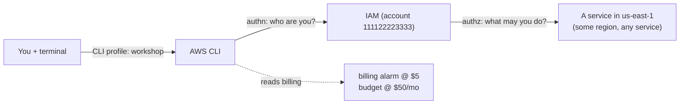

# Stage 1 — AWS account, IAM, and the AWS CLI

> Stage 2 of 10 · still $0 · ~1–2 hours · [prerequisites](../prerequisites.md) done first

## Learning objectives

- Prove — with a command, not a memory — which account and region every future
  command will touch.
- Create a dedicated IAM user and CLI profile for the workshop.
- Explain authentication vs authorization, policies vs roles, and least
  privilege — in your own words.
- Install the cost guardrails (billing alarm + budget) **before** creating any
  billable resource.

## New AWS concepts

1. **Account** — the security and billing boundary (this workshop: one account,
   two environments later).
2. **Region** — an independent deployment of each service; resources never
   cross regions by accident, and empty lists are not errors.
3. **IAM user** — an identity with credentials (here: long-lived access keys,
   with an SSO note for real life).
4. **Policies vs roles** — policies *say* what's allowed; roles are identities
   *other things* assume (the workshop builds roles for ECS tasks and Lambda
   from Stage 3 on; this stage just plants the vocabulary).
5. **Least privilege** — grant the minimum that works, then add when reality
   demands it.
6. **Billing alarm + Budget** — alarms on spend are a first-class habit, not
   bookkeeping.

## Architecture

Nothing exists yet. The "system" you build this stage is *you, wired to the
account correctly*:

## What you will build (and why)

### 1. An IAM user for the workshop (in the account you prepared)

Create an IAM user (e.g. `workshop-admin`) with enough permissions to do the
whole workshop: manage IAM roles/policies, VPC, ECR, ECS, ELB, Lambda, SQS,
DynamoDB, CloudWatch, and billing alarms/budgets. Attach an AWS-managed
policy that covers that breadth (read what it actually grants — that's the
exercise). Real life would scope far tighter; a workshop moves faster than
least-privilege debates.

**Real-life note (read it now):** organizations should use IAM Identity
Center (SSO) or short-lived role credentials instead of long-lived IAM-user
access keys. We use the IAM-user path so every CLI command "just works" while
you're learning. Do not paste the access key into any file in this repo — it
goes in the CLI's own encrypted configuration.

### 2. A dedicated CLI profile named `workshop`

Configure a *named profile* (not the default) with the new user's credentials
and region **us-east-1**. Every command for the rest of this workshop should
either include the profile explicitly or set `AWS_PROFILE=workshop` in your
shell. The payoff: "which account am I on?" becomes a habit answerable in
5 seconds, not a guess.

**Why a named profile:** the default profile is where muscle memory lives.
Keeping `workshop` separate means your production credentials (if any) and
the workshop can never silently mix.

### 3. Cost guardrails — before anything billable exists

- A **billing alarm at $5** (total estimated charges). This is your runaway
  detector: it fires the same day something is billing by the hour that
  shouldn't be.
- A **monthly budget of $50** with alerts at 80% and 100%. Expected
  steady-state spend for the workshop is ~$70/month in the final stages, so
  the 80% ($40) alert mid-project should *not* surprise you — read
  [cost-estimates.md](../cost-estimates.md) once now so alerts have context.

### 4. Learn the identity triple-check

Three commands, until they're muscle memory (use `--help` to see what each
reports):

- `aws sts get-caller-identity` — *which credentials* are actually in use
  (account, user ARN).
- `aws configure list` (with the profile) — *which region*.
- The service you're about to touch: e.g. `aws ec2 describe-vpcs` — *what's
  already there* before you create more.

Run all three right now, and read every field of the output. The account ID
and region from that output are the "you are here" of everything that follows.

## Verification

- [ ] `sts get-caller-identity` shows the workshop account and your user — via
  the `workshop` profile specifically (`aws sts get-caller-identity
  --profile workshop` vs without: notice the difference if your default
  profile differs).
- [ ] Region: your profile says us-east-1, and you can name one CLI way to
  override region per-command.
- [ ] Inspect one policy you're attached to: find the policy document and read
  a Statement — what Effect / Action / Resource does it grant?
- [ ] The billing alarm exists (`aws cloudwatch describe-alarms`) and the
  budget exists (budgets are their own CLI namespace — find it).
- [ ] `aws ec2 describe-vpcs` returns something (probably one default VPC)
  — and you can explain why that command was safe to run.

## Checkpoint

### You should now have

- IAM user + `workshop` profile, region pinned.
- Billing alarm ($5) and monthly budget ($50, 80/100% alerts).
- Zero billable resources. Keep it that way until Stage 2.

### Verify

All checks above, plus this mental one: say out loud *which account and
region* a bare `aws ec2 describe-instances` would hit on your machine, and
what makes you sure.

### You should be able to explain

- The difference between "I am tamir@company" (authentication) and "tamir may
  call `ecs:CreateCluster`" (authorization).
- Why an IAM *role* has no password and no access key — and who holds its
  credentials instead.
- Why an empty list from a `describe-*` command is dangerous.
- What fires first if you forget to delete a NAT Gateway next month: the
  alarm, the budget alert, or nothing.

### Break it

1. Run a `describe-*` command with an explicit **wrong region** flag. What
   comes back — an error, or silence? What should you double-check before
   trusting that output?
2. Create (or simulate) a second profile/user with a **read-only** policy
   (e.g. `ViewOnlyAccess`) and attempt a create command with it. Read the
   entire error text: it names the missing action. That message is IAM
   teaching you its vocabulary — get comfortable with it now.

### Debug it

- For break 2: before reading the solution, answer: which *statement* in
  which *policy* denied you? How would you find the policy attached to the
   identity you used? (Solutions for every break live in
   [troubleshooting-solutions.md](../troubleshooting-solutions.md) — S1-1, S1-2.)

### Cost check

**$0** — IAM, profiles, alarms, and budgets are free. Everything from Stage 2
on bills; the guardrails you just installed are what keeps that boring.

## What changed from the previous stage

You went from "has an AWS account" to "has a verified, cost-instrumented,
region-disciplined way to talk to exactly one account" — the platform every
later stage stands on.