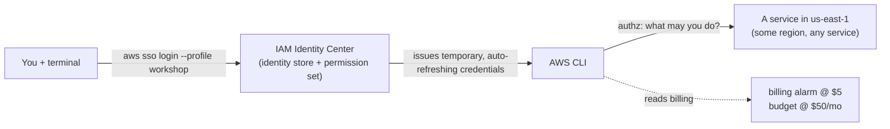

# Stage 1 — AWS account, SSO, and the AWS CLI

> Stage 2 of 10 · still $0 · ~2–3 hours · [prerequisites](../prerequisites.md) done first

## Learning objectives

- Prove — with a command, not a memory — which account and region every future
  command will touch.
- Enable IAM Identity Center and connect the AWS CLI to it, so every command
  runs with short-lived SSO credentials instead of a long-lived access key.
- Explain authentication vs authorization, permission sets vs roles, and least
  privilege — in your own words.
- Install the cost guardrails (billing alarm + budget) **before** creating any
  billable resource.

## New AWS concepts

1. **Account** — the security and billing boundary (this workshop: one account,
   two environments later).
2. **Region** — an independent deployment of each service; resources never
   cross regions by accident, and empty lists are not errors.
3. **IAM Identity Center (SSO)** — AWS's workforce identity store and access
   portal. You sign in once (with MFA) and it hands out temporary credentials.
4. **Permission set** — a reusable bundle of policies. Identity Center turns it
   into an IAM role in each account you assign it to; you never manage that
   role by hand.
5. **Policies vs roles** — policies *say* what's allowed; roles are identities
   *things* assume. This stage makes you assume a role through SSO; later stages
   build roles for ECS tasks and Lambda.
6. **Least privilege** — grant the minimum that works, then add when reality
   demands it.
7. **Billing alarm + Budget** — alarms on spend are a first-class habit, not
   bookkeeping.

## Architecture

Nothing exists yet. The "system" you build this stage is *you, wired to the
account correctly — the way a real company would do it*:



## What you will build (and why)

### 1. Enable IAM Identity Center — the workshop's SSO

In the AWS Management Console, open **IAM Identity Center** and enable it. Pick
**us-east-1** so your identity region matches the region discipline used for
everything else in this workshop (and so there is exactly one region to reason
about).

- **Standalone account (no organization yet):** enabling Identity Center
  creates an AWS Organization with this account as the management account. This
  is expected and costs nothing.
- **Account that is already an AWS Organizations member:** you may not be able
  to create an organization instance. Either ask your management-account
  administrator to enable Identity Center and assign you, or create a limited
  **account instance**. If your company already runs SSO, this is where you
  connect.

**Real-life note (read it now):** in a company, the identity source behind
Identity Center is usually the corporate directory — Okta, Microsoft Entra ID,
or Active Directory — synchronized with SCIM. Here we use Identity Center's
built-in directory so nobody needs an external IdP. The mechanics you learn are
identical.

### 2. Create your workshop user

In Identity Center, create a user (e.g. `workshop-admin`) with your email
address. Accept the invitation, set a password, and **register MFA** (an
authenticator app or a passkey).

This is deliberately *not* an IAM user: it has no access key and no long-lived
credential. Note the **AWS access portal URL** shown in the Identity Center
dashboard — that is your SSO start URL and you will paste it into the CLI in a
moment.

### 3. Create the `WorkshopAdmin` permission set

Create a permission set named `WorkshopAdmin` with a **session duration of 12
hours** (the maximum). The session duration is how long your SSO login lasts
before you must sign in again — setting it to the max is what keeps this
workshop from nagging you every hour.

Attach the AWS-managed **`AdministratorAccess`** policy — enough breadth to
create roles/policies, VPCs, ECR repos, ECS clusters, load balancers, Lambda
functions, SQS queues, DynamoDB tables, CloudWatch resources, and
budgets/billing alarms. Read what it actually grants; that is the exercise.
Real life would scope far tighter.

**Billing gotcha:** if you choose a narrower policy later, make sure it can read
billing (the budget and the CloudWatch billing alarm need
`aws-portal:ViewBilling` / `ce:*`). `AdministratorAccess` already covers it.

When you assign the permission set (next step), Identity Center creates a role
in the account named like `AWSReservedSSO_WorkshopAdmin_<hash>`. That role — not
a user — is the real authorization boundary. You never edit it by hand.

### 4. Assign access and connect the AWS CLI

Assign the `WorkshopAdmin` permission set to the `workshop-admin` user for this
account.

Now configure a *named CLI profile* (not the default) using the SSO wizard:

```bash
aws configure sso --profile workshop
```

Answer the prompts with: session name `workshop`, the **SSO start URL** from §2,
SSO region `us-east-1`, registration scope `sso:account:access`, then select this
account, the `WorkshopAdmin` role, default region `us-east-1`, output `json`, and
profile name `workshop`. The wizard writes a profile and a reusable
`sso-session` into `~/.aws/config`:

```ini
[profile workshop]
sso_session = workshop
sso_account_id = 111122223333
sso_role_name = WorkshopAdmin
region = us-east-1
output = json

[sso-session workshop]
sso_region = us-east-1
sso_start_url = https://your-portal.awsapps.com/start
sso_registration_scopes = sso:account:access
```

> `sso_region` is where **Identity Center** lives; `region` is where your AWS
> **resources** live. They are usually the same here (us-east-1), but they are
> not the same thing — know which one you are changing.

Sign in:

```bash
aws sso login --profile workshop
```

Your browser opens, you authenticate (MFA!), and the CLI caches a token. Every
command for the rest of this workshop should either include `--profile workshop`
or run with `AWS_PROFILE=workshop` set in your shell.

**Session gotcha (this is the price of SSO).** AWS credentials obtained through
SSO are valid for 60 minutes and the CLI refreshes them automatically **while
your SSO session token is alive**. The token's lifetime is the permission set's
session duration (you set it to 12 hours). When it expires you will see an SSO
token error and the cure is one command: `aws sso login --profile workshop`.

**Why a named profile:** the default profile is where muscle memory lives.
Keeping `workshop` separate means your production credentials (if any) and the
workshop can never silently mix.

**Already did the old long-lived IAM-user setup?** Remove that user's access
key (and the user) once you are authenticated through SSO, so there is exactly
one way in.

### 5. Cost guardrails — before anything billable exists

- A **billing alarm at $5** (total estimated charges). This is your runaway
  detector: it fires the same day something is billing by the hour that
  shouldn't be. It lives in **us-east-1**.
- A **monthly budget of $50** with alerts at 80% and 100%. Expected
  steady-state spend for the workshop is ~$70/month in the final stages, so the
  80% ($40) alert mid-project should *not* surprise you — read
  [cost-estimates.md](../cost-estimates.md) once now so alerts have context.

### 6. Learn the identity triple-check (now four steps)

Run these until they are muscle memory (use `--help` to see what each reports):

1. `aws sso login --profile workshop` — get (or refresh) credentials.
2. `aws sts get-caller-identity` — *which credentials* are in use (account and
   the assumed-role ARN).
3. `aws configure list` — *which region*.
4. The service you're about to touch: e.g. `aws ec2 describe-vpcs` — *what's
   already there* before you create more.

Read every field of the output. In step 2 you will see an **assumed-role** ARN
(`arn:aws:sts::…:assumed-role/AWSReservedSSO_WorkshopAdmin_…/you@example.com`),
not a user ARN. That is the whole lesson of SSO in one line: you sign in as
*you*, but you act as a *role* for a limited time.

## Verification

- [ ] `aws sso login --profile workshop` succeeds and opens the browser.
- [ ] `aws sts get-caller-identity --profile workshop` shows the workshop
  account and an assumed-role ARN for `WorkshopAdmin` (not an IAM user). Compare
  with a bare `aws sts get-caller-identity` if your default profile differs.
- [ ] `aws configure list --profile workshop` shows us-east-1, and the profile
  has no secret — because SSO holds the credentials.
- [ ] Inspect the `WorkshopAdmin` permission set: read the policy document and
  say what Effect / Action / Resource it grants. Find the matching
  `AWSReservedSSO_WorkshopAdmin_*` role (`aws iam list-roles`).
- [ ] The billing alarm exists (`aws cloudwatch describe-alarms`) and the budget
  exists (budgets are their own CLI namespace — find it).
- [ ] `aws ec2 describe-vpcs` returns something (probably one default VPC) — and
  you can explain why that command was safe to run.

## Checkpoint

### You should now have

- IAM Identity Center enabled in us-east-1; `workshop-admin` user + MFA; the
  `WorkshopAdmin` permission set assigned to the account.
- The `workshop` SSO profile, region pinned, and the `aws sso login` habit.
- Billing alarm ($5) and monthly budget ($50, 80/100% alerts).
- Zero billable resources. Keep it that way until Stage 2.

### Verify

All checks above, plus this mental one: say out loud *which account and
region* a bare `aws ec2 describe-instances` would hit on your machine, and what
makes you sure.

### You should be able to explain

- The difference between "I am tamir@company" (authentication) and "tamir may
  call `ecs:CreateCluster`" (authorization).
- Why `sts get-caller-identity` shows an *assumed-role* ARN, and why that role
  has no password and no access key — and who holds its credentials instead.
- Why the IAM-user + access-key path is discouraged, and what SSO changes about
  credential lifetime.
- Why an empty list from a `describe-*` command is dangerous.
- What fires first if you forget to delete a NAT Gateway next month: the alarm,
  the budget alert, or nothing.

### Break it

1. Run a `describe-*` command with an explicit **wrong region** flag. What comes
   back — an error, or silence? What should you double-check before trusting
   that output?
2. Create a second permission set `WorkshopReadOnly` with the AWS-managed
   **`ViewOnlyAccess`** policy, assign it to your user, configure a second
   profile with `aws configure sso --profile workshop-ro`, and attempt a create
   command with it. Read the entire error text: it names the missing action.
   That message is IAM teaching you its vocabulary — get comfortable with it.
3. Log out (`aws sso logout`) — or let your session expire — and immediately run
   a `describe-*` command with `--profile workshop`. What error do you get, and
   what single command fixes it?

### Debug it

- For break 2: before reading the solution, answer: which *statement* in which
  *policy* denied you? How would you find the policy behind the permission set
  you used?
- For break 3: how could you tell the difference between "SSO session expired"
  and "your role lacks this permission" from the error text alone?
  (Solutions for every break live in
  [troubleshooting-solutions.md](../troubleshooting-solutions.md) — S1-1, S1-2,
  S1-3.)

### Cost check

**$0** — IAM Identity Center is offered at no additional charge, and profiles,
alarms, and budgets are free. Everything from Stage 2 on bills; the guardrails
you just installed are what keeps that boring.

## What changed from the previous stage

You went from "has an AWS account" to "has SSO-based, MFA-protected,
cost-instrumented, region-disciplined access to exactly one account" — the
platform every later stage stands on.
