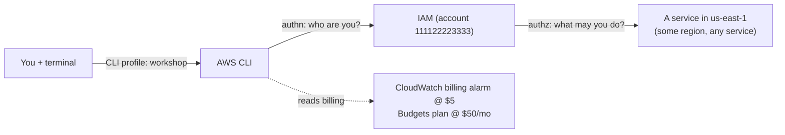

# Stage 1 — AWS account, IAM, and the AWS CLI

> Stage 2 of 10 · still $0 · ~1–2 hours · [prerequisites](../prerequisites.md) done first

## Learning objectives

- Prove — with a command, not a memory — which account and region every future
  command will touch.
- Create a dedicated IAM user and CLI profile for the workshop.
- Read an ARN field by field and say what it identifies.
- Explain authentication vs authorization, policies vs roles, and least
  privilege — in your own words.
- Tell a billing alarm from a budget: two different tools answering two
  different spend questions.
- Install the cost guardrails (billing alarm + budget) **before** creating any
  billable resource.

## New AWS concepts

1. **Account** — the security and billing boundary (this workshop: one account,
   two environments later).
2. **Region** — an independent deployment of each service; resources never
   cross regions by accident, and empty lists are not errors.
3. **ARN (Amazon Resource Name)** — the unique name of every AWS thing;
   policies grant actions on ARNs, and error messages name them.
4. **IAM user** — an identity with credentials (here: long-lived access keys,
   with an SSO note for real life).
5. **Policies vs roles** — policies *say* what's allowed; roles are identities
   *other things* assume (the workshop builds roles for ECS tasks and Lambda
   from Stage 3 on; this stage just plants the vocabulary).
6. **Least privilege** — grant the minimum that works, then add when reality
   demands it.
7. **Billing alarm + Budget** — two *different* services (CloudWatch Alarms and
   AWS Budgets) that answer two different questions about spend. Both are a
   first-class habit, not bookkeeping.

## Architecture

Nothing exists yet. The "system" you build this stage is *you, wired to the
account correctly*:



## What you will build (and why)

### 1. An IAM user for the workshop (in the account you prepared)

Create an IAM user (e.g. `workshop-admin`) and attach **two** AWS-managed
policies:

| Policy | ARN | What it gives you |
|---|---|---|
| `AdministratorAccess` | `arn:aws:iam::aws:policy/AdministratorAccess` | Everything the workshop touches: IAM, VPC, ECR, ECS, ELB, Lambda, SQS, DynamoDB, CloudWatch |
| `AWSBudgetsActionsWithAWSResourceControlAccess` | `arn:aws:iam::aws:policy/AWSBudgetsActionsWithAWSResourceControlAccess` | The AWS Budgets namespace (`budgets:*`) plus the billing/portal reads that an admin policy does **not** include |

**Yes, two policies — and the second one is the interesting one.**
`AdministratorAccess` is broad, but "administrator" does *not* mean "billing":
AWS keeps budgets and the billing portal in their own service namespaces
(`budgets`, `aws-portal`), which `AdministratorAccess` deliberately omits. A
budget you cannot create is not a guardrail — so this stage grants exactly that
one extra slice and nothing more.

Then create an access key for the user and configure the `workshop` profile
(§2). Do not paste the access key into any file in this repo — it goes in the
CLI's own configuration.

**Real-life note (read it now):** organizations should use IAM Identity
Center (SSO) or short-lived role credentials instead of long-lived IAM-user
access keys. We use the IAM-user path so every CLI command "just works" while
you're learning.

#### Least privilege, demonstrated (then deliberately set aside)

`AdministratorAccess` is the "get the workshop finished" choice, not the
engineering choice. To see the trade-off, price out the scoped alternative.
Instead of `AdministratorAccess`, you could attach one AWS-managed policy per
capability the workshop actually uses:

| Need | AWS-managed policy |
|---|---|
| IAM roles + policies | `IAMFullAccess` |
| VPC / networking | `AmazonVPCFullAccess` |
| Container registry | `AmazonEC2ContainerRegistryFullAccess` |
| ECS | `AmazonECS_FullAccess` |
| Load balancer | `ElasticLoadBalancingFullAccess` |
| Lambda | `AWSLambda_FullAccess` |
| SQS | `AmazonSQSFullAccess` |
| DynamoDB | `AmazonDynamoDBFullAccess` |
| CloudWatch | `CloudWatchFullAccess` |
| Billing alarm | included in CloudWatch |
| Budgets | `AWSBudgetsActionsWithAWSResourceControlAccess` (or `budgets:*`) |

That set is tighter in intent — but it is uglier to manage, it still overshoots
reality (you need `CreateCluster`, not the whole ECS surface), and it buys almost
nothing for a workshop. Attaching it would cost you ten policies and a naming
scavenger hunt; attaching two gets you a lesson in what least privilege would
cost. For the workshop, take the two.

**The exercise is not to adopt the scoped set — it is to read what you
granted.** Go through both policies above and inspect their JSON: IAM →
Policies → search the name → the **{} JSON** view (or
`aws iam get-policy-version --policy-arn <arn> --version-id v1`). Read the
`Statement`s and notice:

- `AdministratorAccess` is one statement: `"Effect": "Allow"`,
  `"Action": "*"`, `"Resource": "*"`. No scope at all — which is precisely why
  the workshop only uses it on a throwaway account.
- `AWSBudgetsActionsWithAWSResourceControlAccess` is a small, legible statement
  list: `budgets:*`, `aws-portal:ViewBilling`, `aws-portal:ModifyBilling`,
  `iam:PassRole` (conditioned on `budgets.amazonaws.com`), and a few
  `List*`/`Describe*` reads.
- Neither policy scopes `Resource` to a specific ARN — AWS-managed policies
  cannot, which is the real reason least privilege usually means *writing your
  own* policy with exact ARNs. You will do exactly that for task roles in
  Stages 7–9.

### 2. A dedicated CLI profile named `workshop`

Configure a *named profile* (not the default) with the new user's credentials
and region **us-east-1**. Every command for the rest of this workshop should
either include the profile explicitly or set `AWS_PROFILE=workshop` in your
shell. The payoff: "which account am I on?" becomes a habit answerable in
5 seconds, not a guess.

**Why a named profile:** the default profile is where muscle memory lives.
Keeping `workshop` separate means your production credentials (if any) and
the workshop can never silently mix.

**Make the profile comfortable (oh-my-zsh users).** Typing `--profile workshop`
on every command is fine, but if you use [oh-my-zsh](https://ohmyz.sh/) you can
let the shell hold it for you. Enable its built-in `aws` plugin:

```bash
nano ~/.zshrc
```

Find the `plugins=(...)` line and add `aws` to it (keep the rest — it is one
space-separated parenthesised list):

```zsh
plugins=(git ... aws)
```

Then reload the shell so the change takes effect:

```bash
source ~/.zshrc
```

The plugin requires AWS CLI v2 and adds:

- `asp workshop` — sets `AWS_PROFILE=workshop` for that shell session (run `asp`
  with no argument to clear it), plus `asp workshop login` for SSO setups.
- `asr us-east-1` — sets `AWS_REGION` for that shell session.
- `aws_profiles` / `aws_regions` — completion for the two commands above.
- `aws_prompt_info` — a prompt segment (e.g. `<aws:workshop <region:us-east-1>`)
  showing the active profile and region, so "which account am I on?" is on
  screen, not in your head.

With the plugin loaded, a fresh terminal becomes: open it, run `asp workshop`,
and every `aws` command in this tutorial hits the right account and region
without a flag. Not on oh-my-zsh? Skip all of this — `--profile workshop` and
`export AWS_PROFILE=workshop` are the portable equivalents.

### 3. The shape of an ARN

Every AWS resource has a name, and that name is an **ARN** — Amazon Resource
Name. You already met two in §1
(`arn:aws:iam::aws:policy/AdministratorAccess`), `get-caller-identity` will hand
you a third (your user's), and from Stage 7 on, the IAM policies you write grant
actions **on an exact ARN** instead of on `*`. Read one properly, once:

```text
arn:aws:iam::111122223333:user/workshop-admin
 │   │   │   │          │     └── resource       what, inside the service
 │   │   │   │          └──────── resource type  optional; often the "kind"
 │   │   │   └─────────────────── account ID     12 digits, or `aws` for AWS itself
 │   │   └─────────────────────── region          EMPTY when the service is global
 │   └─────────────────────────── service         iam, s3, ec2, sqs, dynamodb, …
 └─────────────────────────────── partition       aws (or aws-cn / aws-us-gov)
```

Six fields, always in that order, separated by colons. Reading them out loud is
a habit worth building — the region and account are your "you are here".

| # | Field | What it means | In `arn:aws:iam::111122223333:user/workshop-admin` |
|---|---|---|---|
| 1 | `partition` | Which AWS cloud you're on | `aws` (commercial; GovCloud/China differ) |
| 2 | `service` | The AWS product | `iam` |
| 3 | `region` | Geographic endpoint | **empty** — IAM is global |
| 4 | `account-id` | Owning account (12 digits), or `aws` for AWS-owned | `111122223333` |
| 5 | `resource type` | Optional namespace inside the service | `user` |
| 6 | `resource` | The specific thing | `workshop-admin` |

Workshop ARNs you will meet (note how the resource field changes shape):

| Resource | ARN |
|---|---|
| IAM user | `arn:aws:iam::111122223333:user/workshop-admin` |
| AWS-managed policy | `arn:aws:iam::aws:policy/AdministratorAccess` |
| S3 bucket | `arn:aws:s3:::aws-task-app-frontend` |
| EC2 instance (Stage 2 test vehicle) | `arn:aws:ec2:us-east-1:111122223333:instance/i-0abc…` |
| ECR repository (Stage 3) | `arn:aws:ecr:us-east-1:111122223333:repository/aws-task-app-backend` |
| ECS task definition (Stage 3) | `arn:aws:ecs:us-east-1:111122223333:task-definition/dev-backend:1` |
| ALB (Stage 4) | `arn:aws:elasticloadbalancing:us-east-1:111122223333:loadbalancer/app/dev-alb/…` |
| SQS queue (Stage 7) | `arn:aws:sqs:us-east-1:111122223333:dev-task-events` |
| DynamoDB table (Stage 8) | `arn:aws:dynamodb:us-east-1:111122223333:table/dev-tasks` |
| Lambda function (Stage 7/9) | `arn:aws:lambda:us-east-1:111122223333:function:dev-task-created-consumer` |

Five rules that make ARNs stop being noise:

1. **Empty fields are meaningful, not missing.** IAM has no region
   (`arn:aws:iam::`). S3 has no region *and* no account (`arn:aws:s3:::` —
   three colons in a row).
2. **`aws` as the account means AWS owns it**, not you — every AWS-managed
   policy lives at `arn:aws:iam::aws:policy/…`.
3. **The service decides the resource syntax.** Compare
   `…:ec2:…:instance/i-0abc` (`type/id`), `…:dynamodb:…:table/dev-tasks`
   (`type/id`), `…:sqs:…:dev-task-events` (bare id), and
   `…:lambda:…:function:dev-task-created-consumer` (`type:name`). Don't assume
   `/`; copy the real string.
4. **ARNs are exact strings.** There is no fuzzy matching: a policy scoped to a
   `us-east-2` DynamoDB ARN will not authorize a `us-east-1` table, and the
   error names both. This is exactly the Stage 8 break-it exercise.
5. **Policies use wildcards freely** — `arn:aws:s3:::aws-task-app-*`,
   `arn:aws:dynamodb:us-east-1:111122223333:table/*`. The `"Resource": "*"` in
   `AdministratorAccess` is simply the everything-wildcard; seeing it in a
   policy should now feel alarming, not invisible.

An ARN is a name, not a URL and not a secret — safe to paste into a terminal, a
policy, or a ticket. Which is also why it is the right thing to copy out of a
console screen instead of retyping: a typo'd ARN fails closed.

### 4. Cost guardrails — before anything billable exists

Do this in the **AWS Management Console**, not the CLI. Two reasons: enabling
billing alerts and creating budgets are console-shaped workflows, and the
`aws budgets` command surface is verbose and easy to get subtly wrong. You
should also see the Billing console at least once — it is where you will check
reality for the rest of the workshop. (The CLI is for *inspecting* that an alarm
exists once it does; see Verification.)

#### 4a. A $5 billing alarm (CloudWatch Alarms)

1. **Enable billing alerts first** — Billing and Cost Management → **Billing
   Preferences** → **Alert preferences** → tick **Receive Billing Alerts**.
   Without this, the `EstimatedCharges` metric never appears and step 2 has
   nothing to watch. One-time, account-level.
2. CloudWatch → **Alarms** → **All alarms** → **Create alarm** → **Select
   metric** → the **Billing** namespace → **Total Estimated Charge** →
   statistic **Maximum**. The Billing namespace only exists if step 1 is done.
3. **Region must be US East (N. Virginia) `us-east-1`** — billing metrics are
   published nowhere else, no matter where your resources live.
4. Conditions: threshold type **Static**, **Greater than 5**, period
   **6 hours** (billing data lags hours; 6 h avoids noise).
5. Notification: **Create a new SNS topic** (e.g. `workshop-billing-alarm`) with
   your email; **confirm the subscription** from your inbox. (An unconfirmed SNS
   subscription silently drops every email.)
6. Name the alarm e.g. `workshop-billing-5usd`.

**Read this before the email arrives.** The workshop's expected spend is ~$70–80
for the month, so **you will cross $5 around Stage 2** — the NAT Gateway alone
runs about $0.045/hour (~$33/month). The first alarm email is therefore **not a
failure**; it is proof the *detector works*. Note the date, confirm the email
actually arrived (check spam for the SNS confirmation and the alarm), and carry
on. From that point on, the budget's *forecast* alerts are your real signal.

The reason to build the $5 alarm anyway is what comes *after* the workshop: when
you park or tear down, then a forgotten NAT Gateway, Elastic IP, or idle Fargate
task quietly restarts the meter, $5 is your same-day tripwire — long before the
monthly budget's forecast would shout. The guardrails outlive the tutorial.

#### 4b. A $50 monthly budget (AWS Budgets)

Billing and Cost Management → **Budgets** → **Create budget** → **Use a
template** → **Monthly cost budget** (or Customize → Cost budget), amount
**$50**:

- **80% of budget ($40) — ACTUAL spend.** A "you're on the plan" warning.
  Expected steady-state is ~$70/month in the final stages, so this *should* fire
  mid-project. That is normal, not a problem.
- **100% of budget ($50) — FORECASTED spend.** The important one: AWS warns you
  *before* the run-rate actually puts you over $50. (Prefer to be pinged only on
  real money? Add a third alert at 100% ACTUAL as well.)

Enter your email for each alert and create the budget.

#### 4c. A billing alarm is not a budget

Both monitor spend, but they are different services, different data models, and
they answer different questions. AWS's own naming does not help here — the
confusion is understandable.

|  | Billing alarm | Budget |
|---|---|---|
| Service | CloudWatch Alarms | AWS Budgets |
| Question it answers | "Have I crossed this amount right now?" | "Am I on track to spend my plan?" |
| Data model | One metric: `EstimatedCharges` (running monthly total) | A plan ($50/mo) vs ACTUAL and FORECASTED spend |
| Regions | `us-east-1` only (billing metrics live nowhere else) | Any region |
| CLI namespace | `aws cloudwatch` | `aws budgets` (its own namespace) |
| Trigger types | Threshold on the current value only | ACTUAL, FORECASTED, and RI/Savings Plans utilization & coverage |
| Notification | SNS topic (→ email) | Email or SNS, direct |
| Re-notify? | No — fires once, latches until month rollover | Yes — can re-notify as the forecast shifts |
| Granularity | Whole account (or by service, with more setup) | Per service, per tag, per linked account, per purchase option |
| Cost | Free (the alarm is free; SNS email is free) | Free — first 2 budgets are free, then $0.02/day each |
| Deploy speed | Instant, but data lags up to ~6 h | Instant, data also lags |

Think of it as: **a CloudWatch alarm is a threshold on a number; a budget is a
plan you track against.** The alarm answers *"have I crossed $5 right now?"* The
budget answers *"am I on track to spend my plan?"* You want both — the first
catches the runaway today, the second catches the trajectory.

### 5. Learn the identity triple-check

Three commands, until they're muscle memory (use `--help` to see what each
reports):

- `aws sts get-caller-identity` — *which credentials* are actually in use
  (account, user ARN).
- `aws configure list` (with the profile) — *which region*.
- The service you're about to touch: e.g. `aws ec2 describe-vpcs` — *what's
  already there* before you create more.

Run all three right now, and read every field of the output. The account ID
and region from that output are the "you are here" of everything that follows.

## Verification

- [ ] `sts get-caller-identity` shows the workshop account and your user — via
  the `workshop` profile specifically (`aws sts get-caller-identity
  --profile workshop` vs without: notice the difference if your default profile
  differs). Copy your user ARN from the output and name all six ARN fields out
  loud.
- [ ] Region: your profile says us-east-1, and you can name one CLI way to
  override region per-command.
- [ ] Inspect the policies you're attached to
  (`aws iam list-attached-user-policies --user-name workshop-admin`), then read
  one policy document (`aws iam get-policy-version --policy-arn <arn>
  --version-id v1`): what Effect / Action / Resource does each Statement grant?
- [ ] The billing alarm exists (`aws cloudwatch describe-alarms` — again, the
  alarm lives in us-east-1) and you can say why it must.
- [ ] The budget exists with both alerts (budgets are their own CLI namespace —
  find it: `aws budgets describe-budgets --account-id <your-account-id>`), and
  the SNS email subscription is **confirmed** (check your inbox).
- [ ] `aws ec2 describe-vpcs` returns something (probably one default VPC) — and
  you can explain why that command was safe to run.
- [ ] oh-my-zsh users: in a fresh terminal, `asp workshop` sets the profile and
  the prompt shows it.

## Checkpoint

### You should now have

- IAM user + `workshop` profile, region pinned.
- Billing alarm ($5) and monthly budget ($50, 80/100% alerts).
- Zero billable resources. Keep it that way until Stage 2.

### Verify

Open a **fresh terminal** with no `AWS_PROFILE` and no `--profile` flag, then
run:

```bash
aws ec2 describe-instances
```

What happens — and why? Your credentials live only under the `workshop` profile,
so the CLI falls back to the `default` profile, finds nothing, and fails (or, if
you *do* have a default profile configured, silently talks to that account — the
more dangerous outcome). Now make it work:

```bash
export AWS_PROFILE=workshop   # or, with the oh-my-zsh plugin: asp workshop
aws ec2 describe-instances
```

That failure-then-success pair is the entire point of a named profile: nothing
hits AWS until you say *which* account, and every later stage repeats it.

### You should be able to explain

- The difference between "I am tamir@company" (authentication) and "tamir may
  call `ecs:CreateCluster`" (authorization).
- Why an IAM *role* has no password and no access key — and who holds its
  credentials instead.
- Why an empty list from a `describe-*` command is dangerous.
- What fires first if you forget to delete a NAT Gateway next month: the alarm,
  the budget alert, or nothing.
- How to read an ARN field by field — and why `arn:aws:iam::…` has an empty
  region while `arn:aws:s3:::…` has an empty region *and* account.
- Why the workshop attaches two policies instead of one, and what the scoped
  ten-policy alternative would buy (and cost) you.
- Which question the $5 alarm answers, which question the $50 budget answers,
  and which one will email you first this month.

### Break it

1. Run a `describe-*` command with an explicit **wrong region** flag. What comes
   back — an error, or silence? What should you double-check before trusting
   that output?
2. Create (or simulate) a second profile/user with a **read-only** policy (e.g.
   `ViewOnlyAccess`) and attempt a create command with it. Read the entire error
   text: it names the missing action. That message is IAM teaching you its
   vocabulary — get comfortable with it now.

### Debug it

- For break 2: before reading the solution, answer: which *statement* in which
  *policy* denied you? How would you find the policy attached to the identity
  you used? (Solutions for every break live in
  [troubleshooting-solutions.md](../troubleshooting-solutions.md) — S1-1, S1-2.)

### Cost check

**$0** — IAM, profiles, alarms, and budgets are free. Everything from Stage 2 on
bills; the guardrails you just installed (alarm + budget, both in the console)
are what keeps that boring.

## What changed from the previous stage

You went from "has an AWS account" to "has a verified, cost-instrumented,
region-disciplined way to talk to exactly one account" — the platform every
later stage stands on.
