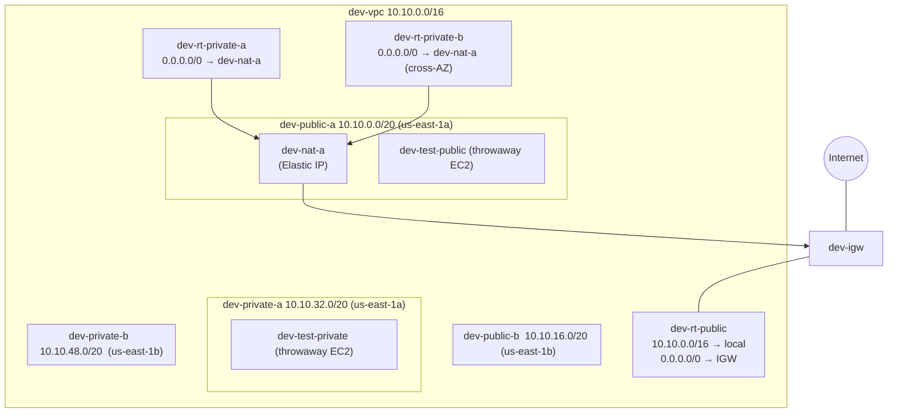

# Stage 2 — The Dev VPC

> Stage 3 of 10 · first real money (~$33/mo line) · 3–4 hours · region: us-east-1, AZs us-east-1a + us-east-1b

**This is the most important stage of the workshop.** Everything after it —
containers, databases, queues — rides on the network you build here, and the
later stages deliberately keep sending you back to it. Take your time.

## Learning objectives

- Build a VPC with two Availability Zones, public and private subnets, an
  Internet Gateway, and exactly one NAT Gateway.
- Answer, with evidence from route tables: *what makes a subnet public?*
- Prove connectivity rules empirically with throwaway EC2 instances.
- Explain the single-NAT cost trade-off (and sketch the production fix).

## New AWS concepts

1. **VPC** — your private slice of one region's network (an address space you
   fully control).
2. **CIDR** — how address ranges are written; the `/16`, `/20` notation.
3. **Availability Zone** — physically separate data centers; the unit of
   "not all eggs in one building".
4. **Subnet** — a CIDR *inside* the VPC, pinned to one AZ.
5. **Route table** — the only thing that decides what a subnet can reach.
   (Public/private is a route-table property, not a checkbox.)
6. **Internet Gateway** + **NAT Gateway** — the two doors to the outside: IGW is
   bidirectional for public IPs; NAT lets *private* things call out while
   blocking calls in.

## Architecture

Before: an empty region. After:

Read the diagram's two story lines: public subnets reach the internet **via
the IGW directly**; private subnets reach it **via the NAT**, which itself
sits in a public subnet. Every arrow is a route-table entry or an attachment —
nothing is reachable by default.

## What you will build (and why)

### 1. The plan (draw it before you click anything)

| Resource | Value | Notes |
|---|---|---|
| VPC | `dev-vpc`, `10.10.0.0/16` | ~65k private addresses |
| Subnets | `dev-public-a` `10.10.0.0/20`, `dev-public-b` `10.10.16.0/20`, `dev-private-a` `10.10.32.0/20`, `dev-private-b` `10.10.48.0/20` | /20 ≈ 4,091 usable each; **a/b = us-east-1a/1b** |
| IGW | `dev-igw`, attached to `dev-vpc` | the region-facing door |
| Route tables | `dev-rt-public` (+ `dev-rt-private-a`, `dev-rt-private-b`) | one public, one per private subnet |
| NAT | `dev-nat-a` in `dev-public-a`, with an Elastic IP | one NAT **per VPC**, not per AZ — see sidebar |

Why four subnets: each AZ gets a public subnet (for ALBs and NATs later) and
a private subnet (for containers and data later). Why two AZs: because
Stage 4's ALB demands it, and because AZ redundancy is the cheapest resilience
in AWS. Why `/20`s: readable, non-overlapping, and Prod uses the same pattern
in `10.20.0.0/16`.

### 2. Subnets, IGW, and the public routing

Create the VPC and four subnets; create and attach the IGW; create
`dev-rt-public` with `10.10.0.0/16 → local` (implicit, check it's there) and
`0.0.0.0/0 → dev-igw`; associate **both** public subnets with it.

Before moving on, write down your answer to the core question:
**what makes a subnet public?** (You'll get to test it in a moment — hold
yourself to a route-table-level answer, not "AWS said so".)

### 3. Prove it: throwaway EC2 test vehicles

Launch two tiny EC2 instances (Amazon Linux 2023, **t3.micro**, terminate
them before the stage ends) as scientific instruments, nothing more:

- `dev-test-public` in `dev-public-a` — **auto-assign public IP enabled**,
  reachable via SSH (key pair `dev-test-key`, security group `dev-sg-ssh`
  allowing SSH from *your* IP only — not 0.0.0.0/0).
- `dev-test-private` in `dev-private-a` — **no public IP**.

Expected results, which you should verify, not assume:

- From `dev-test-public`: `curl example.com` **works**. From your laptop:
  SSH works.
- From `dev-test-public` SSH to `dev-test-private`'s **private IP** works —
  intra-VPC traffic needs no internet at all; the `local` route carries it.
- From `dev-test-private`: `curl example.com` **hangs and fails**. No route
  out. This failure is a feature — you're looking at what "private" means.

### 4. The NAT Gateway and private routing

Create `dev-nat-a` **in `dev-public-a`** with a fresh Elastic IP. Create
`dev-rt-private-a` and `dev-rt-private-b`, each with `0.0.0.0/0 → dev-nat-a`,
and associate the private subnets. Now from `dev-test-private`,
`curl example.com` **works** — and answer honestly: whose IP is the internet
seeing? (Hint: it isn't the instance's private IP, and it isn't "nobody".)

> **Cost sidebar — why one NAT, and what production would do.** A NAT Gateway
> bills ~$0.045/hr ≈ **$33/month**, plus $0.045/GB processed. The textbook HA
> layout is one NAT **per AZ** — that would be 4 NATs across Dev+Prod later
> (2 AZs × 2 VPCs) ≈ $130/month, which is more than this workshop's entire
> budget. So this VPC has **one**, and `dev-rt-private-b` routes
> **cross-AZ** through it. The trade-off: if us-east-1a fails, outbound
> internet from *both* private subnets fails with it. On paper (do it now):
> sketch the two-NAT variant for this VPC — which subnets change, which route
> tables change, which AZ's private subnet now survives an AZ-a outage.
> Production does what you just drew; the workshop pays for the lesson, not
> the redundancy.

### 5. Read it all back through the CLI

Inspect what you built — CLI, not Console (names in brackets; use `--help`):

- describe the VPC, the subnets (which AZ is each in?), the IGW attachment
- describe each route table and **explain every line** to a rubber duck:
  the `local` route, the `0.0.0.0/0 → igw` vs `→ nat` difference
- describe the NAT Gateway (which subnet? which EIP?)

## Verification

- [ ] Four subnets exist across two AZs, exactly matching the table above.
- [ ] `dev-rt-public` has the IGW route; both private route tables have the
  NAT route; nothing else custom.
- [ ] EC2 evidence: public instance curls the internet; private instance
  SSHable *from* the public one; private instance curls the internet **only
  after** the NAT route exists.
- [ ] You captured the NAT's public IP — and matched it to what
  `checkip.amazonaws.com` reports from inside `dev-test-private`.
- [ ] **Terminate both test vehicles and delete `dev-test-key`** once the
  evidence is in. (They're free-tier-eligible, but leaving instances around
  is how habits rot.)

## Checkpoint

### You should now have

- `dev-vpc` with 2 AZs, 4 subnets, IGW, 1 NAT GW (EIP), 3 route tables.
- First-hand proof of every connectivity rule in the diagram.
- Zero leftover EC2s.

### Verify

All checks above, plus: for each of these four claims, say *route* or *no
route* and name the route-table entry: (a) private→internet outbound,
(b) internet→private inbound, (c) public→private, (d) private-a→private-b.

### You should be able to explain

- What makes a subnet public — and why two identical subnets in different
  route tables have different superpowers.
- Why the NAT Gateway lives in a **public** subnet and what its EIP is for.
- Why inbound connections to `dev-test-private` are impossible even though
  its outbound curl works.
- What breaks in this exact VPC if us-east-1a dies, and what the production
  layout would change.

### Break it

Do these on your real VPC, observe, then revert (each break is independent;
revert before the next):

1. Remove the `0.0.0.0/0 → igw` route from `dev-rt-public` while
   `dev-test-public` is running. Predict first, then verify: instance still
   "running" — but what happens to your SSH session and to its curl?
2. Remove the NAT route from a private route table (or detach it into a new
   empty table). Verify from inside `dev-test-private`.
3. Rebuild the NAT Gateway **in a private subnet** and point a private route
   table at it. This is everyone's production outage eventually — what
   exactly does the private instance experience?

### Debug it

For each break: is the failure *fast* (refused — an authority rejected you)
or *slow* (timeout — packets went nowhere)? What does that difference tell
you about where the traffic died? Theories first, then
[troubleshooting-solutions.md](../troubleshooting-solutions.md) S2-1…S2-3.

### Cost check

**New monthly run-rate: ~$33** — the NAT Gateway, the single biggest line of
the whole workshop. Everything else this stage (VPC, subnets, route tables,
IGW, SGs) is **free**. The EC2s cost ~$0 (free-tier eligible, minutes of
runtime — and you terminated them, right?). If you pause >1 week before
Stage 3, park Dev's NAT (delete it + release the EIP) —
[teardown.md](../teardown.md) has the exact checklist.

## What changed from the previous stage

AWS stopped being "an account with guardrails" and became **a network**: a
region-scoped address space with two kinds of subnets and two doors to the
internet. Stages 3–9 place every workload inside this map — and keep asking
you route-table questions. Keep the diagram above within arm's reach; you
will annotate it three more times (Stages 4, 5, 8).