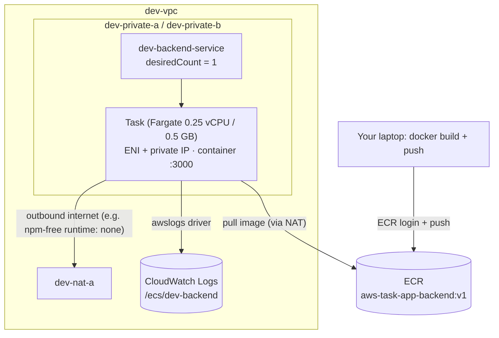

# Stage 3 — Docker, ECR, ECS task, ECS service

> Stage 4 of 10 · adds ~$9/mo · 3–4 hours · app version **v1** · sub-parts 3a/3b/3c

## Learning objectives

- Package the pre-written backend into a container image and push it to ECR.
- Explain cluster vs task definition vs task vs service — and desired state.
- Run the backend as a Fargate task inside **private** subnets and reach it
  deliberately.
- Understand the two IAM roles every ECS task involves (execution vs task
  role) and the ENI-per-task networking model.

## New AWS concepts

1. **Docker image vs container** — a built snapshot vs a running instance of it.
2. **ECR** — a private regional registry for your images; ECS pulls from here.
3. **ECS cluster / task definition / task / service** — the four-layer model.
4. **Fargate** — serverless containers: you never see an instance, you pay for
   vCPU+GB per task-second.
5. **Task networking (awsvpc)** — every task gets its own ENI + private IP in
   your subnet.
6. **Execution role vs task role** — the role that *starts* the container
   (pull image, write logs) vs the role *inside* the container (talk to AWS
   services — empty in v1, load-bearing from Stage 7).

## Architecture

Before: an idle VPC. After (3c):

Two flows to notice before building: the **pull** (task → ECR, through the
NAT — Stage 2's routes doing real work) and the **logs** (task → CloudWatch,
via the execution role's permission, not any route — CloudWatch has no
subnet). Different resources, different paths, different permissions.

## What you will build (and why)

### 3a — Image and ECR

1. Skim the backend's `Dockerfile` once (reading only — students never edit
   it): multi-stage build (TypeScript compile with dev deps, then a runtime
   stage with prod deps + compiled `dist/`), non-root user, `ENVIRONMENT` and
   `PORT` expected at runtime, never baked in.
2. Build and tag the image locally, pointing the tag at your ECR URI.
3. Create the ECR repository **first** (`aws-task-app-backend` — check its
   default image immutability setting while you're there), then authenticate
   Docker to ECR (the login password is a *token from an STS-issued API call*
   — read what `aws ecr get-login-password` actually does), and push.

Every push produces an image digest — note it; it's the content-addressed
truth of "what exactly is running", versus the mutable `:v1` tag.

### 3b — Cluster, task definition, one-off task

1. Create cluster `dev-cluster` (Fargate networking mode — the "cluster" is
   almost empty bookkeeping; the interesting config lives in task definitions
   and services).
2. **Roles first, then tasks.** Create `dev-backend-execution-role` — the
   role ECS *uses to start your container*: it needs ECR pull and CloudWatch
   Logs write. Find the two AWS-managed policies that grant exactly this
   pair (that's the exercise; their names are famously ugly). The **task
   role** (`dev-backend-task-role`) is the container's *own* identity for
   calling AWS services — create it empty in v1 and watch how Stage 7 (SQS)
   and Stage 8 (DynamoDB) will fill it. Separating these two roles is the
   first IAM-for-services lesson: one identity for the machinery, one for
   the app.
3. Task definition `dev-backend` (Fargate): 0.25 vCPU / 0.5 GB (the smallest
   Fargate size — cost is a design constraint), the ECR image, container port
   **3000** (what the app binds — `PORT` env), env vars `ENVIRONMENT=dev`,
   `PORT=3000`, the execution role, the (empty) task role, the **awslogs**
   log driver into `/ecs/dev-backend`, and `dev-private-a` + `dev-private-b`
   as the network. Read each field's doc text as you fill it — the console
   help here is genuinely good.
4. **Run a one-off task** (`run-task`, not a service) in `dev-private-a`.
   Find its ENI's private IP (the task details — or `aws ec2
   describe-network-interfaces` — because with awsvpc networking *a task is
   literally an ENI in your subnet*).

**Reach it deliberately.** The task is private: no public IP, no route in.
Two honest options — (a) briefly relaunch a Stage 2-style `dev-test-public`
EC2 and curl `http://<task-private-ip>:3000/health` **intra-VPC**; or (b) use
EC2 Instance Connect / SSM to avoid SSH keys entirely. Either way, notice
what *didn't* work first: curling the private IP from your laptop. Why not?

Verify `/health` and create a task or two via `curl POST`. Then **stop the
one-off task** and note that nothing replaces it — a task is a *unit of
execution*, and only a service maintains a desired count. That's 3c.

### 3c — The service

Create `dev-backend-service` in `dev-cluster` from task definition
`dev-backend`, desired count **1**, spread across both private subnets.
Watch it: pull → provision ENI → start → running, then find the new task's
private IP and curl `/health` again.

Now the **desired state** exercise: kill the running task (stop it — the CLI
   has this under `ecs`). Watch the service replace it within seconds
   without being asked. Say the sentence precisely: *a service maintains
   desired count; a task definition defines what a task is; a task is one
   execution*. Which layer "noticed" the kill, and which layer "decided" to
   restart? (Also note the replacement's private IP is different — and
   nothing outside the VPC even knows.)

## Verification

- [ ] Image in ECR (`aws ecr describe-images`): `v1` tag, size < 200 MB
  (multi-stage pays off).
- [ ] Task definition revision 1 exists with both roles, 3000, env vars,
  awsvpc, both private subnets.
- [ ] Service stable, 1 running task, logs flowing into `/ecs/dev-backend`
  — read one request-completed line and match its fields to Stage 0's.
- [ ] You killed the task and the service replaced it (evidence in service
  events).
- [ ] The one-off task from 3b is stopped and its ENI is gone
  (`describe-network-interfaces` count back to 1).

## Checkpoint

### You should now have

- ECR repo + pushed `:v1` image.
- `dev-cluster`, `dev-backend` task definition (rev 1), `dev-backend-service`
  (desired 1), both IAM roles, log group `/ecs/dev-backend`.
- A running backend in **private** subnets — reachable only from inside the
  VPC. That is correct; Stage 4 will be the *only* door in.

### Verify

All checks above, plus: from your laptop, `curl <task-private-ip>:3000/health`
must **fail** — and you can name both the routing reason and the
"no-NAT-inbound" reason why.

### You should be able to explain

- Cluster vs task definition vs task vs service — one sentence each.
- Why the image pull needed the NAT Gateway's route (trace it: ENI → subnet →
  route table → NAT → IGW → ECR's public endpoint).
- Execution role vs task role — what each does *here*, and why v1's task role
  can be empty.
- What "awsvpc networking" means for what a task *is* on your subnet.

### Break it

1. **Wrong container port:** register a new task-definition revision with
   container port 80 (and leave `PORT=3000`). Run a one-off task and try both
   ports from your test vehicle. Which layer "owns" each of the two numbers?
   (Revert.)
2. **Sever the pull path:** temporarily delete the NAT route from
   `dev-rt-private-a` (Stage 2 muscle memory), then force a new task (stop
   the running one and let the service replace it — into whichever subnet
   the scheduler picks). Read the *stopped task reason*. This is S3-2 in the
   solutions doc — and the single most common "why won't my container start"
   in private-subnet ECS. (Restore the route afterwards.)

### Debug it

For break 2: the service wanted desired=1, the task failed — where does the
*reason* live (stopped task events? log group? both?), and why are the
service's own event messages less useful than the task's? Theories first,
then [troubleshooting-solutions.md](../troubleshooting-solutions.md) S3-1, S3-2.

### Cost check

**New: ~$9/mo** — one 24/7 Fargate task (0.25 vCPU/0.5 GB ≈ $0.012/hr). ECR
storage: cents. The NAT from Stage 2 is now load-bearing — if it's deleted,
containers can't even start (you proved it in break 2). Cumulative run-rate:
~$42/mo.

## What changed from the previous stage

The VPC gained its first real workload: a containerized API running as a
desired-state service in the private subnets, pulling its own image through
the NAT you built, shipping JSON logs to CloudWatch. Missing piece: no door
for users — Stage 4 builds exactly one.