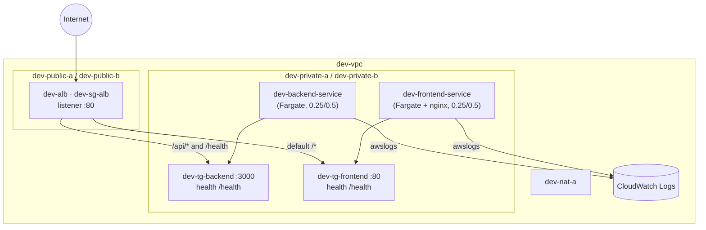

# Stage 4 — ALB, security groups, and the frontend (Version 1 checkpoint)

> Stage 5 of 10 · adds ~$26/mo · 2–3 hours · app version **v1**

## Learning objectives

- Expose the backend through exactly one internet door: an Application Load
  Balancer in public subnets.
- Route by **path**: `/api/*` and `/health` to the backend, everything else to
  a second Fargate service serving the React build with nginx.
- Build a security-group chain with **SG references**, not CIDR holes.
- Trace one full request end-to-end — and finish **Version 1**.

## New AWS concepts

1. **Application Load Balancer** — the one internet-facing entry point; also
   the health-checking, target-supervising layer.
2. **Listener + rules** — what the ALB does with an incoming request (path
   matching → target group).
3. **Target group** — a named set of targets (here: ECS tasks) + a health
   check that decides "is this target alive".
4. **SG references** — a security-group rule that *points at another SG*
   rather than an IP range.
5. **Static hosting via nginx** — a second, trivially simple Fargate service
   (the "not now" alternative: S3+CloudFront is the textbook answer for
   static sites, but this stage is about ECS/VPC/networking — don't pile on
   services; know that you consciously chose not to).

## Architecture

Before: backend reachable only intra-VPC. After — **the Version 1 shape**:



The security-group chain, which is the heart of this stage:

```text
internet → dev-sg-alb      (inbound 80 from 0.0.0.0/0 — it's the front door)
         → dev-sg-backend  (inbound 3000 FROM dev-sg-alb — reference, not CIDR)
         → dev-sg-frontend (inbound 80   FROM dev-sg-alb — reference, not CIDR)
```

Nothing else may enter: tasks stay unreachable from the internet even though
they serve internet users.

## What you will build (and why)

### 1. Security groups first (the door decides who enters)

Create three SGs in `dev-vpc`:

- `dev-sg-alb`: inbound TCP **80 from 0.0.0.0/0** (the only place the whole
  workshop ever accepts the internet).
- `dev-sg-backend`: inbound TCP **3000**, source = *the `dev-sg-alb` group
  itself* (paste its `sg-…` id as the rule's source — that's a reference,
  and it stays correct no matter which AZ/IP the ALB runs in).
- `dev-sg-frontend`: inbound TCP **80**, source = `dev-sg-alb`.

Update the `dev-backend` service's tasks to use `dev-sg-backend` (new task
def revision — changing an SG requires re-registering; note that security
groups attach to the *ENI*, and awsvpc means the task's ENI).

### 2. The ALB, target groups, and path rules

- Create `dev-alb` in the **public** subnets, both AZs (why? — an internet
  door with an AZ redundancy story), with `dev-sg-alb`.
- Create `dev-tg-backend`: protocol HTTP, port **3000**, target type
  **ip** (awsvpc tasks are IP targets), health check path **/health** — the
  endpoint the app guarantees. Health check *interval/thresholds*: defaults
  are fine; know which knob is which.
- Create `dev-tg-frontend`: port **80**, health **/health** too — the nginx
  config serves a 200 there (check `nginx.conf` in the repo — one location
  block, and *no proxy_pass anywhere*: nginx is a file server; the ALB does
  the routing).
- Listener :80 with rules, in priority order: **`/api/*` →
  dev-tg-backend**, **`/health` → dev-tg-backend** (a single extra path rule
  so *you* can probe the backend through the door too), **default `/*` →
  dev-tg-frontend**.
- Why this design and not CORS/origins/baked URLs: the frontend speaks
  relative URLs (`/api/...`) — same origin always. One DNS name, no CORS,
  no build-time config, and the ALB's rules are the only thing that knows
  where `/api` goes. (Stage 0's proxy — the exact same idea.)

### 3. The frontend service

Build and push the frontend image (ECR repo `aws-task-app-frontend`, tag
`:v1` — it will never change again in this workshop; only the backend
versions up). Create task definition `dev-frontend` (0.25/0.5 GB, container
port 80, `dev-sg-frontend`, execution role reused, log group
`/ecs/dev-frontend`), service `dev-frontend-service` desired 1 in the
private subnets, registered to `dev-tg-frontend` — that last option lives in
the *service*, not the task def: the service keeps exactly N tasks in the
target group.

### 4. The full request trace (do it slowly, once)

1. Browser → ALB DNS name → header shows **`Environment: dev`**.
2. Devtools → Network: `?` — the tasks arrive in the same response as the
   page; confirm which requests hit `/*` (static bundle) vs `/api/...`.
3. Create a task, complete it, then find the matching JSON log lines in
   `/ecs/dev-backend` (CloudWatch console → Log groups, or start practicing
   `aws logs tail`).
4. Name every hop of `POST /api/tasks`: browser → ALB (rule `/api/*`) →
   target group → ENI → container → response. Which security group checked
   you at which point?

## Verification

- [ ] ALB DNS name serves the app; `Environment: dev` header correct.
- [ ] `curl <alb-dns>/health` → backend JSON; `curl -I <alb-dns>/` →
  frontend's index; both target groups report their single target **healthy**
  (this page — health status — is your Stage 4/6 dashboard forever).
- [ ] `aws elbv2 describe-target-groups` / `describe-rules`: you can restate
  every listener rule from memory.
- [ ] From your laptop, `curl <task-private-ip>:3000` still fails; from inside
  the VPC, `curl`ing the ALB's **private** IP works. Why? (SG chain + routes.)
- [ ] Stop the backend task; watch the ALB health-check fail the target while
  the service replaces the task and health returns — the three layers
  (ALB/service/task) each doing exactly their own job.

## Checkpoint — **Version 1**

### You should now have

Dev, fully assembled: VPC (2 AZs, public/private, IGW+1 NAT), ECR images
`backend:v1` + `frontend:v1`, two ECS services behind one path-routing ALB
with a chained SG design, CloudWatch log groups for both services. **This is
the Version 1 checkpoint of the spec.**

```text
            Internet
                │
            ┌───▼───┐
            │  ALB  │           dev-vpc
            └───┬───┘  ┌────────────────────────────┐
        ┌───────┼─────►│ private subnets             │
   /api/* ┐    │      │  ┌───────────┐ ┌───────────┐ │
   /*   └─► tg backend│  │ ECS svc  │ │ ECS svc   │ │
          └───────────┘  │ backend  │ │ frontend  │ │
          └──────────────►└───────────┘ └───────────┘ │
                          CloudWatch ◄─────────────── │
                          NAT → IGW (egress)          │
                          └─────────────────────────── ┘
```

### Verify

All checks above, plus answer the **ten Version-1 questions** in writing,
one sentence each (they compress everything so far):

1. How does an HTTP request reach the ECS container — every hop, in order?
2. Why is the ECS task in a **private** subnet?
3. Why is the ALB in **public** subnets?
4. How do route tables affect traffic for this exact request path (both the
   inbound leg and any outbound leg)?
5. What does a security group do — and what does the SG *reference* in
   `dev-sg-backend`'s rule buy you over a CIDR?
6. What is an ECS *task*?
7. What is an ECS *service*, and what did you observe it do (desired state)?
8. How does ECS get the container image — which role, which route, which
   registry?
9. Where do the application logs go, and what exactly writes them there?
10. How are Dev and Prod isolated — wait, they don't exist yet. Answer the
    version you can: why is *nothing else* in this VPC reachable from the
    internet except port 80 on the ALB?

### You should be able to explain

Everything in the ten questions above — plus: why the frontend image will
never need rebuilding in Stages 5–9, and why one DNS name with path rules
beats two origins (CORS) for this app.

### Break it

Each break is independent — observe, then revert:

1. Delete the ALB→backend SG-reference rule from `dev-sg-backend`. Predict the
   target group's behavior *before* looking (hint: who performs health checks,
   and from which identity?). Then check target health and hit `/api/tasks`.
2. Re-create `dev-tg-backend` with port 80. Same-looking symptom as break 1 —
   now debug *without* guessing: what's identical (504s/unhealthy) and what
   distinguishes them?
3. Change the backend health-check path to `/`. Which targets go unhealthy,
   and — the subtle part — why does *user traffic* still work briefly?
4. Register a task definition revision that puts the backend service in the
   **public** subnets. Note what the ALB thinks (still healthy — why?), and
   what you just did to the security posture. Revert immediately. (Never skip
   this revert.)

### Debug it

For every break: state the layer (rule / port / path / subnet) *before*
touching anything, name the evidence (target health page, ALB 5xx metric, log
absence), then fix. Then compare against [troubleshooting-solutions.md](../troubleshooting-solutions.md) S4-1…S4-3 — and note how breaks 1 and 2 had
identical symptoms and different causes: that's why you trace chains, not
symptoms.

### Cost check

**New: ~$26/mo** (ALB ~$17 + a second Fargate task ~$9). Cumulative Dev
run-rate: **~$68/mo**. This is the peak "single environment" cost of the
workshop — Stage 5 adds the *second* VPC but parks it, so the number barely
moves. Pause >1 week? [Park it](../teardown.md).

## What changed from the previous stage

The backend got a door (ALB), a doorman (SG chain), and a companion service
(frontend). "Version 1" — the synchronous, one-environment, boring-in-a-good-way
full-stack app — is finished. Stage 5 duplicates the pattern for Prod, and
then the interesting question becomes: *how do you keep two environments from
stepping on each other?*