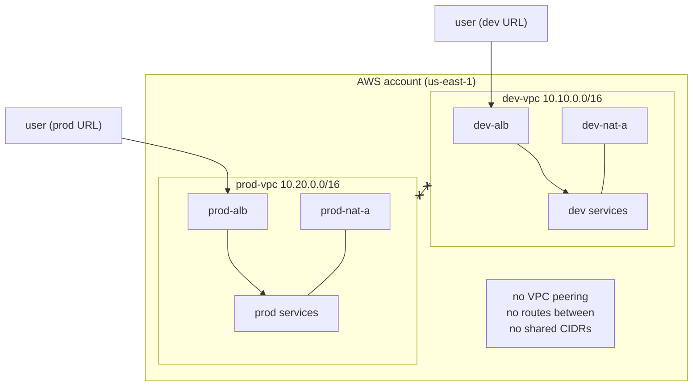

# Stage 5 — The Prod VPC and environment isolation

> Stage 6 of 10 · ~$0/mo when parked (≈$1 total in deploy windows) · 2–3 hours · app version **v1**

## Learning objectives

- Build the entire Version-1 pattern again, independently, for Prod
  (`10.20.0.0/16`).
- Prove — by trying and failing — that isolation is a **network property**,
  not a naming convention or an env var.
- Learn the two "prod hygiene" habits this workshop bakes in: naming
  discipline and **parking**.

## New AWS concepts

1. **Environment isolation by network** — separate VPCs, no routes between.
2. **Naming conventions at scale** — `dev-`/`prod-` prefixes, identical
   shapes.
3. **VPC peering (attempted)** — and why overlapping CIDRs make it
   impossible.
4. **Parking** — scale to 0 + delete hourly-billed edges; the skeleton is
   free.

(No new service types — the whole point is that you can now build a known
pattern from memory. Do this stage with the Console *closed*: CLI only,
referring to your own Stage 2–4 history.)

## Architecture

Before: Dev. After: two self-contained stacks in one account:

The `x--x` is the stage: the architectures are *identical* and *unconnected*.

## What you will build (and why)

### 1. The Prod VPC — from memory, by CLI

Repeat Stage 2 in `10.20.0.0/16`: subnets `prod-public-a/b`,
`prod-private-a/b` in the same /20 pattern; `prod-igw`; route tables
`prod-rt-public` (IGW route) and `prod-rt-private-a/b` (NAT route);
`prod-nat-a` with an EIP. Then Stages 3–4's pattern: ECR images are shared
(the same `:v1` tags — images aren't environment-specific; only task
definitions differ), but everything else is new and `prod-`-named:
`prod-cluster`, `prod-backend`/`prod-frontend` task definitions
(`ENVIRONMENT=prod` — the *only* app-level difference), roles
(`prod-backend-execution-role`, `prod-backend-task-role`), services,
`prod-sg-*`, `prod-alb` + target groups, log groups `/ecs/prod-backend`,
`/ecs/prod-frontend`.

Two deliberate questions to answer before you build:

- Why duplicate the *roles* per environment instead of sharing one? (If a
  Stage-7 break-it detaches the wrong policy, which blast radius do you
  want?)
- Why is `ENVIRONMENT=prod` the **only** application-level difference? (What
  would you think of a codebase where "prod mode" needed different code?)

### 2. The V1-in-both-environments comparison

Load both ALB URLs side by side: same app, `Environment: dev` vs
`Environment: prod`. Create a task in each; restart Prod's backend task
(service replaces it — muscle memory now) and confirm the task survives in
Dev-v1 and vanishes in Prod-v1 (both are in-memory v1 — the *databases*
difference arrives in Stage 8, and *only* in Dev; that's deliberate).

### 3. Prove isolation — by attacking it

From `dev-test-public` (relaunch one if you terminated them — terminate
again when done):

1. `curl` a **Prod private IP** (find one via a Prod task's ENI). Expect:
   timeout. Which route would that packet have needed?
2. `curl` the **Prod ALB's public DNS name**. Expect: **success**. Sit with
   this: "isolated environments" and "reachable over the internet" are not
   contradictions — the ALB is *designed* to be reachable from anywhere. If
   prod must be truly private, that's a different design (internal ALB, SG
   allow-lists) — knowing *which* doors you left open is the skill.
3. Try to add a security-group rule on `prod-sg-backend` referencing
   `dev-sg-alb`. The API refuses. Read the error carefully: SG references
   are VPC-scoped; the primitive itself won't bridge the isolation.
4. Create a throwaway third VPC with CIDR `10.10.0.0/16` (deliberately
   colliding with Dev) and try to peer it with `dev-vpc`. The failure is the
   lesson — routing cannot exist over ambiguous address space. Delete the
   throwaway.

### 4. Park Prod (mandatory step, not cleanup)

**Prod is parked the moment its checkpoint passes.** Run the [park
checklist](../teardown.md): scale both Prod services to 0, delete
`prod-nat-a` **and release its Elastic IP**, delete `prod-alb` (+ target
groups). The VPC skeleton, subnets, SGs, route tables, IGW, roles, task
definitions, log groups, and ECR images all stay — **free**.

Why this is okay: everything hourly-billed is gone; everything free stays
assembled so the Stage 9 redeploy is a 15-minute [checklist](../teardown.md),
not a rebuild. "Park, don't demolish" is the pattern for *your* weekend too
(Stage 6+ pauses).

## Verification

- [ ] Prod mirrors Dev: same resources, `prod-` names, `ENVIRONMENT=prod`
  visible in the UI before parking.
- [ ] Isolation evidence recorded: private cross-VPC curl fails; public-ALB
  curl succeeds; SG cross-VPC reference refused; overlapping-CIDR peering
  refused.
- [ ] Throwaway resources (test EC2, third VPC, key pair) deleted.
- [ ] Prod parked: services at 0, NAT gone, EIP released
  (`aws ec2 describe-addresses` — empty for Prod), ALB gone; VPC + subnets
  + route tables + SGs + roles still present.

## Checkpoint

### You should now have

- Two isolated, environment-complete VPCs (Prod parked).
- The V1 comparison done; the isolation failures witnessed personally.
- A billing run-rate that only bills for Dev.

### Verify

- `aws ec2 describe-vpcs` → 2 workshop VPCs + default; describe-addresses →
  1 EIP (Dev's NAT); prod services' desired counts → 0.
- Both ten-question answers from Stage 4 now answer question 10 honestly:
  *How are Dev and Prod isolated?* — your answer should now include: no
  routes, no shared address space, VPC-scoped references, and the honest
  caveat about internet-facing ALBs.

### You should be able to explain

- Why isolation lives in the network layer and what "isolated" concretely
  means here (and what it *doesn't* mean).
- Why environment variables are for behavior differences, never for
  isolation.
- Which Prod resources survived parking, why each is free, and exactly what
  the Stage 9 redeploy will need to rebuild.
- Why the overlapping-CIDR peering failure is a *feature* of routing.

### Break it

1. Attempt the cross-VPC SG reference (§3.3) — done above; now explain the
   error's wording.
2. Attempt overlapping-CIDR peering (§3.4) — done above; write down which
   *specific fields* of the error message identify the conflict.
3. **The trap-check:** after parking, try to reach the Prod ALB URL. What
   does DNS tell you? What's the cheapest way back? (Answer the question
   without redeploying — then leave it parked.)

### Debug it

The two refusals in this stage are the *only* breaks in the workshop where
the fix is "understand, don't repair" — read them as the platform enforcing
good design. Solutions: [troubleshooting-solutions.md](../troubleshooting-solutions.md) S5-1…S5-3.

### Cost check

**New steady-state: ≈$0.** Parked Prod bills nothing monthly; its Stage 5
deploy window cost ~$0.10–0.20 in hours, and Stage 9's redeploy will too.
Cumulative run-rate: still ~$68/mo (all Dev). If you now pause for a week+,
[**park Dev too**](../teardown.md) — every hour of the NAT is $0.045.

## What changed from the previous stage

You built a whole environment from memory, proved isolation by failing to
breach it, and learned to leave things half-assembled (parked) instead of
demolished. From here the workshop stays in Dev: Stage 6 teaches you to see
inside running services; Stages 7–9 rebuild the *architecture* (async,
database, change-data-capture). Networking questions don't go away — Stage
8's "where does the database actually live?" is a Stage-2 question in
disguise.