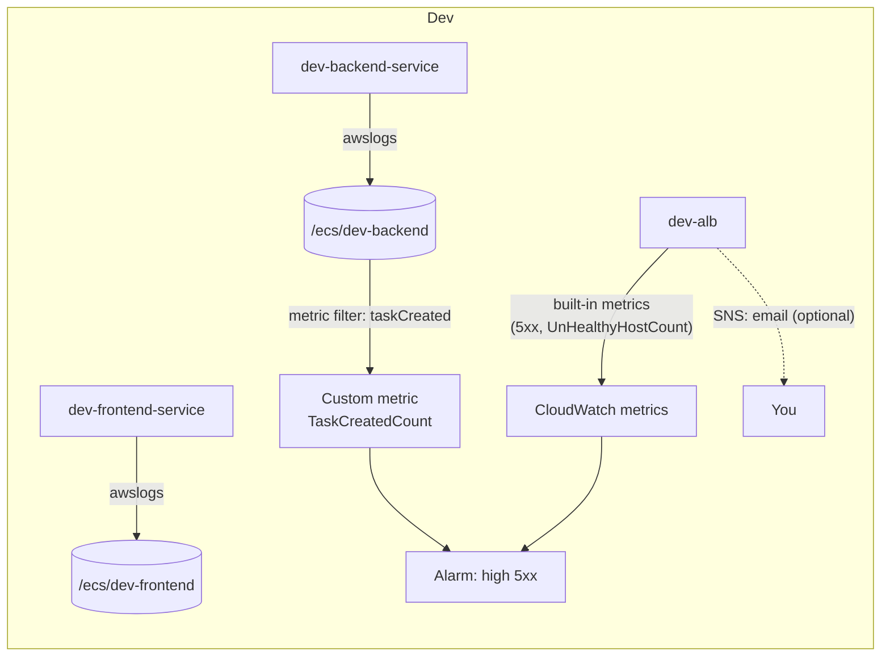

# Stage 6 — CloudWatch: logs, metrics, alarms

> Stage 7 of 10 · ~$1/mo · ~2 hours · app version **v1** · works in Dev; Prod stays parked

## Learning objectives

- Own the observability loop you've been half-using since Stage 3: log
  groups/streams, retention, metric filters, alarms.
- Answer "my app is broken — why?" with evidence instead of guesses.
- Pick the *right* alarm: user-facing signals over CPU aesthetics.

## New AWS concepts

1. **Log groups and log streams** — a group per service (you created these in
   Stage 3 via the awslogs driver); one stream per task (each replacement task
   = a new stream — now you can *read* task churn from the logs view alone).
2. **Retention** — the storage-cost dial; "never expire" is a decision, not a
   default.
3. **Metric filters** — turn log lines into numbers (e.g., count every
   `taskCreated` event).
4. **CloudWatch metrics + alarms** — every AWS service emits metrics; alarms
   turn thresholds into notifications.
5. **The debugging method** — hypothesis → cheapest evidence → repeat
   (stopped-task reason / first log line / target health: the triage trinity).

## Architecture

Nothing new *runs* — you gain instruments pointed at what runs:

## What you will build (and why)

### 1. Learn to read what's already flowing

Since Stage 3, every task has been logging one JSON object per line — the
same lines you read in your terminal in Stage 0. Now practice three reads
(`aws logs` subcommands + the console; the CLI is faster than clicking):

- **Tail the group** and create a task through the UI — watch your POST
  appear, with requestId, status, duration.
- **Find a specific request**: filter the log group by its requestId. This
  is the single most-used debugging move in distributed systems; practice it
  until it's reflex.
- **Read the log *streams* view**: each stream is one task. Stop the backend
  task (service replaces it — expected) and find the new stream appearing.
  Two streams = one replacement happened.

### 2. Retention, on purpose

Set retention on `/ecs/dev-backend` and `/ecs/dev-frontend` — pick 7 days for
this workshop and say why (evidence window vs storage cost). Note the default
you inherited ("never expire") and what that costs at real traffic volumes.

### 3. A metric filter on the business signal

Create a metric filter on `/ecs/dev-backend`: match the `taskCreated` log
event (look at an actual line's fields to write the pattern), emit metric
`TaskCreated` → now "tasks created per minute" is a chart you could alarm on.
This is the bridge from *strings in logs* to *numbers with history* — the
mechanism behind every "business KPI" dashboard that's secretly log parsing.

### 4. Alarms on user-facing signals

Two alarms (email via SNS topic is enough — one notification channel, don't
gold-plate):

- **ALB 5xx** (`HTTPCode_ELB_Target5XX_Count`, or the ALB's
  UnHealthyHostCount) — "users are getting errors" — fires during a crash
  loop (see break 1).
- **ECS service CPU** (`CPUUtilization` on the service) — capacity signal,
  *not* a correctness signal.

While creating them, notice the dimensions you must match (which cluster,
which service) — a metric without its dimensions is a number about nothing.

### 5. The "my app is broken" exercise (facilitator injects this if running a group; solo, self-inject)

Break the config without looking at the fix: register a new `dev-backend`
task-definition revision that **removes `ENVIRONMENT`** (don't peek at the
old revision), update the service, and *debug as if you didn't know*:

1. Symptom check: UI fails via ALB; target group shows unhealthy. Users see
   errors. Your 5xx alarm should be the thing that tells you.
2. Cheapest evidence first: the service's events ("task stopped"), then the
   *stopped task's reason*, then its log stream's **first line**.
3. The app's fail-fast error names the missing variable exactly. Fix by
   creating a corrected revision — notice the fix is one revision, ~1 minute.

**Crash loop mechanics to articulate:** task dies at boot → ECS replaces it →
dies → replaces... The service never "knows" why; it only enforces desired
count. *You* know why because of the stopped-task reason + first log line.
That pair — not the console's green/gray — is the ground truth.

## Verification

- [ ] You can find any request by requestId in under 30 seconds, CLI or
  console.
- [ ] Retention set on both groups; you can state current retention and
  cost-per-GB memory.
- [ ] `TaskCreated` metric shows a datapoint when you create a task (charts
  under "Custom namespaces").
- [ ] Both alarms exist and are green; the 5xx alarm actually fired during
  the crash-loop exercise (then re-armed).
- [ ] The service is healthy again on the corrected revision; the broken
  revision remains in history — read `describe-task-definition` for both and
  diff them.

## Checkpoint

### You should now have

- Working fluency with logs: tail, filter, streams.
- Deliberate retention; one metric filter; two alarms wired to a real channel.
- A lived debugging story: crash loop diagnosed via alarm → service events →
  stopped-task reason → first log line.

### Verify

Re-run the Stage 0 failure: stop the backend task via the console, confirm
the ALB + service recover with zero intervention, and your alarms went quiet
without you doing anything. Observability is what makes boring recovery
acceptable.

### You should be able to explain

- Log group vs log stream, and why task replacements show up as new streams.
- Why "CPU low" says nothing about correctness (your crash loop ran at ~0%).
- The full evidence chain for the crash loop, ordered by cheapness.
- What a metric filter does and why the `TaskCreated` chart is more useful
  than "log lines are piling up".

### Break it

1. The crash loop above (bogus missing env var) — **the** Stage 6 exercise.
2. Set retention to **1 day** on a group, wait a beat, note what queries
   return. What did you lose, in exchange for what?
3. Re-point your 5xx alarm at `CPUUtilization > 80` (wrong metric), re-inject
   the crash loop, and watch it *stay silent*. Fix the alarm, not the lesson:
   alarms must watch the failure mode you actually fear.

### Debug it

For each: write the symptom, the first command you ran, and the evidence that
settled it — one debugging diary entry per break. Then compare with
[troubleshooting-solutions.md](../troubleshooting-solutions.md) S6-1…S6-3. These three entries are the
template for every break in Stages 7–9 — which is why they come *before* the
stages that break things hardest.

### Cost check

**New: ~$1/mo** (log ingestion + storage at tutorial volume; alarms and
metric filters are free; 10 custom metrics are free). Cumulative: ~$69/mo.
Real-world note: logs are famously "free" until they're your second-biggest
line — retention and levels (the app logs *info* by default; `LOG_LEVEL`
exists) are the controls.

## What changed from the previous stage

The stack gained instruments. From here, every stage's breaks are debugged
with Stage-6 tools: the Stage 7 poison message is diagnosed from Lambda logs;
the Stage 8 IAM failure from a `publishFailed`-style error line; the Stage 9
"silent consumer" from a growing queue. Observability is the curriculum's
spine — the remaining stages just hang different failure modes on it.