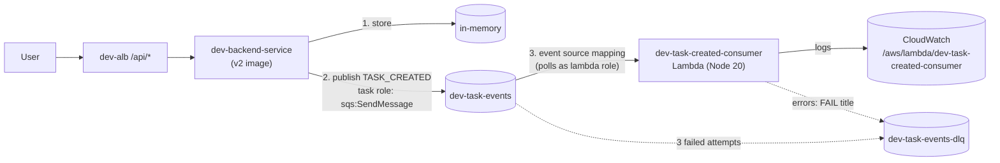

# Stage 7 — SQS + Lambda (switch to **v2**)

> Stage 8 of 10 · ~$0 (free tier at this scale) · 2–3 hours · app version **v2** — the API announces events

## Learning objectives

- Introduce asynchronous, event-driven architecture with the smallest possible
  moving parts: one queue, one Lambda.
- Wire the two new IAM identities correctly: the **ECS task role** (API →
  SQS) and the **Lambda execution role** (Lambda → SQS).
- Configure retries, visibility timeout, and a **dead-letter queue** — and
  then watch a poison message walk the whole path.

## New AWS concepts

1. **SQS** — a durable buffer between producers and consumers; messages wait
   until someone takes them.
2. **Visibility timeout** — how long a message hides after delivery; the
   dial that makes at-least-once delivery *visible*.
3. **DLQ + Redrive policy** — where messages go after
   `maxReceiveCount` failed attempts.
4. **Lambda** — functions-as-a-service; you ship code (already written), AWS
   runs it on events.
5. **Lambda execution role** — the function's identity for talking to AWS.
6. **Event source mapping** — the *managed poller* that reads the queue and
   invokes your function per message/batch.

## Architecture

Before (v1): POST → store → done. After (v2):



**v2's change in one sentence:** the API *explicitly* publishes an event
after doing its synchronous work. Watch for the contrast in Stage 9, where
the database does the announcing.

## What you will build (and why)

### 1. Queues first: `dev-task-events` and its DLQ

Create the **DLQ first** (`dev-task-events-dlq`) — then the main queue
`dev-task-events` with a **Redrive** policy pointing at the DLQ,
`maxReceiveCount = 3`. Why create the DLQ first? The redrive policy
references it; dependencies are real even in queues. While you're in there:
set the main queue's **visibility timeout to 60s** (why ≥ 6× a typical
function timeout is the rule of thumb — you'll see the failure mode in break 2).

### 2. Switch the backend to v2 (deploy-side, not code-side)

1. Build and push `aws-task-app-backend:v2` (from `versions/v2/backend` —
   `docker build`, tag, push; Stage 3 muscle memory).
2. Give `dev-backend-task-role` a **new inline policy**: `sqs:SendMessage`
   on **exactly the ARN of `dev-task-events`** (not `sqs:*`, not `*` —
   least privilege, and the ARN is copy-paste from the queue's details).
   This is the task role's first real job after existing empty since Stage 3.
3. New revision of `dev-backend`: image `:v2`, env adds
   `QUEUE_URL=<dev-task-events URL>` (find it with `aws sqs get-queue-url`).
   Update the service; watch it stabilize.

### 3. Deploy the consumer Lambda (code is pre-written; you configure it)

From `versions/v2/lambdas/task-created-consumer/`: install deps, run
`npm run package` — the script bundles and zips `dist/lambda.zip`. Then:

1. Create execution role `dev-task-created-consumer-role`: trust Lambda; a
   policy granting `sqs:ReceiveMessage`, `sqs:DeleteMessage`,
   `sqs:GetQueueAttributes` on **both** queue ARNs, plus AWS logs write.
2. Create function `dev-task-created-consumer` (runtime Node.js 20, handler
   `index.handler`, 128 MB, 10s timeout), then **code it up from the zip**.
   Skim the source once — note the `FAIL` hook and what it deliberately
   throws for.
3. Create the **event source mapping**: `dev-task-events` → function, batch
   size **1** (why 1? so a failure retries one message, not a whole batch —
   cleanest for observing the mechanics), enabled.

### 4. Observe the intended lifecycle log sequence

Create a task through the UI, then read the two log groups side by side —
this exact sequence is the stage's proof:

```text
/ecs/dev-backend:   "Task created"  (event taskCreated)
/ecs/dev-backend:   "Published TASK_CREATED"  (event taskPublished)
/aws/lambda/dev-task-created-consumer: "Lambda received TASK_CREATED"
/aws/lambda/dev-task-created-consumer: "Lambda processed task"
```

Now make it *fast*: the ALB returned 201 before the Lambda even ran. That
gap — "user already has their answer while the event pipeline is still
working" — is what asynchronous architecture buys, and it's why a dead
consumer never takes down the UI (break 1 proves it).

### 5. Poison messages, on purpose

Create a task titled **`poison FAIL message`** through the UI. Watch:
`Lambda received …` + error, **three times** (who scheduled the retries —
you didn't write any retry code; where does the count 3 come from?), then
find the message in `dev-task-events-dlq` and read its body. Inspect it,
then delete or redrive it. Nobody wrote a "retries then DLQ" feature — it
*emerges* from queue config + a handler that fails.

## Verification

- [ ] Lifecycle sequence above appears for a normal task, in order.
- [ ] `aws sqs get-queue-attributes` on both queues shows the redrive policy
  (maxReceiveCount 3) and visibility timeout 60.
- [ ] Poison task: three `Lambda received` log groups entries + one DLQ
  message; DLQ drained afterwards.
- [ ] Roles audit: task role grants *only* send on the main queue; Lambda
  role grants *only* receive/delete/get on the queues + logs. Neither has
  anything extra — compare and explain the direction of each.
- [ ] Queue depth ≈ 0 at rest (`ApproximateNumberOfMessagesVisible`) — a
  number you'll check reflexively from now on.

## Checkpoint

### You should now have

- `dev-task-events` (+DLQ), `dev-task-created-consumer` Lambda + mapping,
  both new roles, backend on v2.
- Witnessed: at-least-once mechanics, retry policy, DLQ rescue, and a UI
  that keeps working while the async layer is broken.

### Verify

All checks above, plus: with the Lambda **disabled** (pause the event source
mapping — don't delete), create 3 tasks; confirm the UI is perfect and the
queue holds 3 messages; re-enable and watch them drain. "The queue is the
shock absorber" — observed, not asserted.

### You should be able to explain

- Why the task role needed `sqs:SendMessage` but the *execution role* is
  what the *mapping* polls with — and which identity is which.
- What the visibility timeout does, and what duplicate `Lambda received`
  lines mean (S7-2-style misconfiguration).
- Exactly how the FAIL message ended in the DLQ — count, policy, and which
  component decided each step.
- Why the UI survived break 1 (below) and what that implies about decoupling
  — plus the honest cost: publish failures are now *invisible* to users.
- Human permissions (Stage 1's IAM user) vs service permissions (task role,
  Lambda role) — and why services get roles, not passwords.

### Break it

1. Remove `sqs:ReceiveMessage` from the Lambda role. Predict the UI's
   behavior first (fine? broken?), then the *queue's* behavior, then check
   both. Where does the evidence live if the Lambda itself never logs?
2. Set the queue's visibility timeout to **5 seconds**, then redrive (or
   recreate) the poison scenario and watch for duplicate processing. What
   consumer-side cure does this force? (You'll implement the cure's lesson
   in Stage 9's processor.)
3. The poison path (§5) — done as an exercise; if you skimped there, do it now.

### Debug it

For each break: symptom → where would evidence live (Lambda logs? queue
attributes? API logs?) → check — then [troubleshooting-solutions.md](../troubleshooting-solutions.md) S7-0…S7-3. Note how break 1's evidence lives
*outside* the function — the map, not the lambda, tells you.

### Cost check

**~$0**: SQS free tier is 1M requests/month; Lambda free tier is 1M
requests + 400k GB-seconds **every month, forever** — the workshop's traffic
doesn't register. The v2 task runs at the same Fargate size as v1.
Cumulative: ~$69/mo.

## What changed from the previous stage

The architecture gained its first decoupled, async component — with all its
IAM plumbing, retry machinery, and observability paths. v2 taught you "the
API announces." Stage 8 swaps the storage layer under the same API; Stage 9
removes the announcing from the app entirely and lets the *database* emit the
events — watch for which part of this diagram survives.