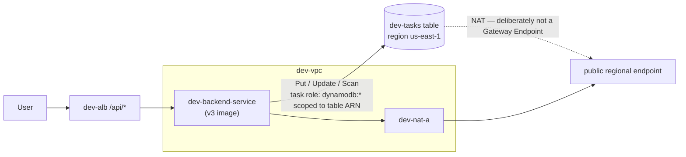

# Stage 8 — DynamoDB (switch to **v3**)

> Stage 9 of 10 · ~$0 (free tier at this scale) · ~2 hours · app version **v3** — persistence, and the networking tie-back

## Learning objectives

- Make tasks survive container restarts by swapping the store for DynamoDB —
  behind the same API, with the same frontend, without a code rewrite.
- Grant the **task role** (not the execution role) tightly-scoped table
  permissions, and watch IAM become a real application dependency.
- **Follow the packets**: trace exactly how a task in a private subnet talks
  to a database that lives in no VPC at all — Stage 2's networking, load-bearing again.

## New AWS concepts

1. **DynamoDB** — a regional, managed NoSQL table: single-digit-millisecond
   key lookups at any scale, no servers, no VPC.
2. **Partition key** — the one attribute that decides where an item lives
   (here: `id` — every item fetched by key).
3. **Regional services vs VPC resources** — DynamoDB has a *public regional
   endpoint*; it is not "inside" your VPC, yet your VPC's routing decides
   whether tasks can reach it.
4. **Task-role permissions per action** — `PutItem`, `UpdateItem`, `Scan` are
   separate permissions on an exact table ARN.
5. **On-demand billing** — pay per request; at tutorial scale, free tier.
6. **(Sidebar) VPC gateway endpoints** — the free, NAT-bypassing route that
   production would add; deliberately not used here, so the dependency stays
   visible and breakable.

## Architecture

Before (v2): API + in-memory store + SQS. After (v3) — note what's *gone*:

**v3 deliberately drops SQS.** No publishing, no Lambda, no event pipeline —
just a persistent synchronous API. Feel the difference: v2's events came from
*application code*; v4's will come from the *database*. The detour through
plain persistence is what makes that contrast real.

## What you will build (and why)

### 1. The table

Create table `dev-tasks`: partition key **`id`** (String), on-demand billing.
No sort key, no secondary indexes — this app does key lookups and lists,
nothing else. (Concept-check while you're in there: why is `id` — a unique
UUID per item — a fine partition key for this app, and what would a
`completed` boolean as partition key be a disaster?)

### 2. Task role: the table policy

Give `dev-backend-task-role` an inline policy granting `dynamodb:PutItem`,
`dynamodb:UpdateItem`, `dynamodb:GetItem`, `dynamodb:Scan`, `dynamodb:Query`
on **exactly the ARN of `dev-tasks`** — copy the ARN from the console
(`describe-table`), don't type it. Note the shape: five *verbs* on *one*
resource. This is the policy you will surgically break later — know its
contents cold.

Which role did you *not* touch? The execution role — pulling images and
writing logs has nothing to do with the app's data. If you're ever unsure
which role a permission belongs to, ask: *who is doing the action — the
machinery or the application?*

### 3. Switch to v3 (deploy-side)

Build/push `aws-task-app-backend:v3`. New task-definition revision: image
`:v3`, env `TABLE_NAME=dev-tasks`, `AWS_REGION=us-east-1`, and **no**
`QUEUE_URL` (v3's config fails fast if it's still set? no — it *fails fast if
missing required vars*; the queue var is simply gone from v3's vocabulary —
remove it, keep the environment clean). Update the service.

### 4. Prove persistence — the whole point

1. Create 2–3 tasks via the UI. Restart the backend task (stop it; the
   service replaces it). **Tasks survive.** First time in the workshop
   this is true — say why (memory died with the container; the table didn't).
2. Kill the *service's* task again and watch a `/api/tasks` fetch during the
   gap: ALB returns 503-ish while the target is unhealthy, then everything
   returns — with data. Persistence + desired state, together.

### 5. The networking tie-back (do not skip this section)

Where does `PutItem` actually go? Trace it fully — Stage 2 pays off now:

1. The task's ENI sits in `dev-private-a`. The table is at a **public DNS
   endpoint** in `us-east-1` — outside the VPC.
2. So the packet follows the private route table: `0.0.0.0/0 → dev-nat-a`
   → EIP → IGW → DynamoDB. The response comes back through the same NAT.
3. **Prove it:** from `dev-test-public` (relaunch briefly), `dig` the
   DynamoDB endpoint's DNS and note the public IPs. Then delete the NAT
   route from `dev-rt-private-a` (break it — break 4 below) and watch the
   app hang on the *next* request — before restoring the route.

> **Sidebar — the free door you're not using.** A **Gateway VPC Endpoint**
> for DynamoDB routes table traffic over AWS's private backbone, never
> touching the NAT — it's *free* and production would add one immediately.
> This workshop skips it **on purpose**: the NAT dependency is the lesson
> (and break 4), and hiding it would make Stage 2's work invisible. Note it
> as "first thing I'd fix": an architecture that only works because a
> $33/month NAT is awake is an architecture worth improving.

## Verification

- [ ] `aws dynamodb describe-table --table-name dev-tasks` shows key schema
  and billing mode exactly as planned.
- [ ] Persistence proof: tasks survive a task restart (and would survive a
  full service redeploy — optional, cheaper: believe the restart).
- [ ] SDK behavior visible in logs: complete a task, find the request log
  line, and the duration is longer than v2's (a network round-trip now
  happens — CloudWatch Logs Insights would chart it if you want).
- [ ] The NAT-path trace: you can name all five hops of a `PutItem` (ENI →
  RT → NAT → IGW → endpoint) — and did break 4.
- [ ] Tasks list ordering is stable across reloads (the store sorts — the
  app code did this so the UI doesn't jitter; a boring detail you only
  notice when it's missing).

## Checkpoint

### You should now have

- `dev-tasks` table; task role with the five-verb table-scoped policy;
  backend on v3, persistent.
- A traced, then *deliberately severed*, network path to the database.

### Verify

- Create → restart task → list (data intact) → complete → restart → list.
- `aws iam get-role-policy`/`list-attached-role-policies` on the task role:
  v3's table policy present; nothing wider.

### You should be able to explain

- Why the task role — not the execution role — holds the table policy.
- Why a DynamoDB table has no subnet, and why your VPC's routing still
  decides whether the app can reach it.
- What a Gateway Endpoint would change in the trace, and why the workshop
  deliberately went without.
- The difference in *failure signatures*: IAM error (fast 500 +
  `AccessDeniedException` in logs) vs network error (slow timeout, no
  authority to reject you). Why does that distinction immediately tell you
  where to look?

### Break it

Each break is one change — observe, revert, then next:

1. Remove **only** `dynamodb:PutItem` from the task-role policy. Predict
   which endpoint breaks and which still works before testing (hint: list
   is `Scan`, create is `Put`). Read the API logs' exact error.
2. Point `TABLE_NAME` at `dev-tasks-typo`. Note the error's name
   (`ResourceNotFoundException`) and when it appears (boot? request?).
   Compare to S6-1's boot-time failure — config validation has limits; know
   where they end.
3. Re-scope the policy's Resource ARN to the wrong region's table ARN.
   Everything "looks" right in the policy editor; the app 500s with
   `AccessDeniedException`. Where do you see the *correct* ARN to compare
   against?
4. Delete the NAT route from `dev-rt-private-a` (§5's trace) — the tie-back
   break. The UI's `/api` calls hang then fail; `/health` (intra-VPC, via
   the ALB) stays **green**. Explain both.

### Debug it

For each: symptom → the one log line that names the culprit → the fix.
These four are the densest IAM+networking debugging reps in the workshop —
diary them like Stage 6. Then compare with
[troubleshooting-solutions.md](../troubleshooting-solutions.md) S8-1…S8-4.

### Cost check

**~$0**: on-demand DynamoDB free tier covers this scale (and real-world
usage stays cheap until real traffic); storage is kilobytes. No new Fargate
size — the SDK's weight is negligible. Cumulative: ~$69/mo. The NAT's
$0.045/GB data processing now includes your DynamoDB traffic — at tutorial
volume, cents; with a Gateway Endpoint, zero (that's the sidebar's point).

## What changed from the previous stage

Tasks became real data (surviving restarts), IAM became an application
dependency (the table policy *is* part of the app now), and the private-subnet
→ public-endpoint path got traced and then stress-tested. v3 is the pause
before the finale: no events, just persistence. Stage 9 re-adds events —
but this time the *table* emits them, and the API goes back to knowing
nothing.