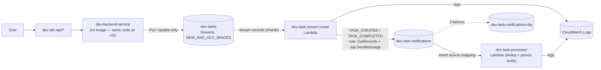
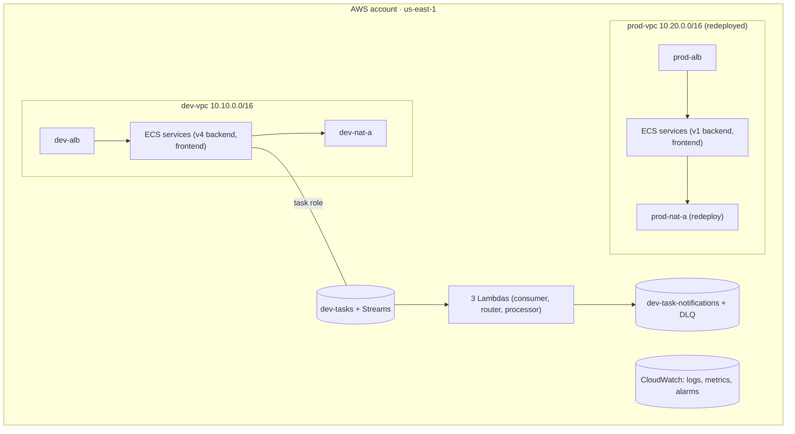

# Stage 9 — DynamoDB Streams and the final architecture (switch to **v4**)

> Stage 10 of 10 · ~$0 services (+ ~$0.20 Prod redeploy window) · ~3 hours · app version **v4** — the database emits events

## Learning objectives

- Enable **change data capture** on the tasks table and let the *database*
  emit the events (v2's API did; v4's table does).
- Wire a two-Lambda pipeline: stream → router Lambda → SQS → processor
  Lambda — with a stream event source mapping and an SQS event source mapping.
- Experience **at-least-once delivery** and idempotency hands-on, with a
  pre-written poison hook and dedup logic.
- Redeploy parked Prod, verify the final two-environment architecture, and
  take the course's self-assessment.

## New AWS concepts

1. **DynamoDB Streams** — a time-ordered feed of item changes
   (`INSERT`/`MODIFY`/`REMOVE`), in the shape you choose (here:
   `NEW_AND_OLD_IMAGES` — needed to detect the completion *transition*).
2. **Change data capture (CDC)** — events derived from state changes instead
   of explicit publish calls.
3. **Stream event source mapping** — Lambda's managed poller, shard-by-shard,
   for streams (Stage 7's SQS mapping's sibling).
4. **At-least-once delivery** — retries and redrives can repeat work; the
   *consumer* must be idempotent.
5. **Idempotency** — dedup keys; here warm-container memory, in real systems
   a table.
6. **Shards + iterators** (lightweight) — streams are split for parallelism;
   the mapping manages iterators for you, and *its* state is why a disabled
   stream breaks mappings.

## Architecture

The final event-driven pipeline (Dev):

And the environment picture this stage ends with:

The regional services (DynamoDB, SQS, Lambda, CloudWatch) sit **outside the
VPC model** — that's deliberate and is one of the self-assessment questions.

## What you will build (and why)

### 1. Enable Streams on `dev-tasks`

Stream view type: **`NEW_AND_OLD_IMAGES`**. Why not `NEW_IMAGE` alone? The
router must detect the *transition* `completed: false → true` for
`TASK_COMPLETED`; without the old image, "was it already complete?" is
unknowable. Grab the **stream ARN** (`describe-table` → `LatestStreamArn`) —
every permission below hangs off it.

**v4's backend is the v3 backend.** Diff `versions/v3/backend` against
`versions/v4/backend` — no application change. The entire pipeline grew
around the database without the app knowing. *That's CDC.* (Your deploy
action for the backend: none, or simply re-tag/push `:v4` to satisfy the
naming — the code is identical.)

### 2. `dev-task-notifications` + DLQ (SQS again, from memory)

DLQ first, then the queue with redrive `maxReceiveCount = 3`, visibility
timeout 60s — Stage 7 muscle memory, unassisted.

### 3. Router Lambda: `dev-task-stream-router`

Package from `versions/v4/lambdas/task-stream-router/` (`npm run package` →
zip — Stage 7 again). Execution role `dev-task-stream-router-role`, trust
Lambda, needs **two** permissions, each scoped exactly:

- **Stream reads on the stream ARN**: `dynamodb:DescribeStream`,
  `dynamodb:GetShardIterator`, `dynamodb:GetRecords` (+ `dynamodb:DescribeTable`
  on the table) — the mapping polls *as this role*.
- **Publish**: `sqs:SendMessage` on `dev-task-notifications`.
- Plus logs write.

Create the function (Node 20, 128 MB), then the **stream event source
mapping**: source = the stream ARN, starting position **LATEST** (you'll
contrast it with TRIM_HORIZON in the breaks), batch size small (10 is fine).

Skim the router source once: it converts stream records into
`{type: TASK_CREATED|TASK_COMPLETED, taskId, title}` messages — INSERT vs
MODIFY-with-completion-transition — and ignores everything else. It holds
**no business logic and no state**; translate-and-forward is a perfectly
respectable Lambda job.

### 4. Processor Lambda: `dev-task-processor`

Package from `versions/v4/lambdas/task-processor/`. Role
`dev-task-processor-role`: `sqs:ReceiveMessage`/`DeleteMessage`/
`GetQueueAttributes` on queue + DLQ, plus logs. Event source mapping from
`dev-task-notifications`, batch size 1, enabled.

Skim its source — two pre-built behaviors you'll exercise: the `FAIL` poison
hook (same rule as Stage 7) and the **dedup set**: a warm container remembers
`type:taskId` keys, so a redelivered event logs `skipped duplicate — already
processed`. The comment block explains its deliberate limitation (cold start
= empty set) — that gap is the discussion, not a bug.

### 5. Observe the full pipeline

1. Create a task → watch: API log (`Task created`), then router log
   (`Stream router published TASK_CREATED`), then processor log (`Task
   processor processed TASK_CREATED`). **The API published nothing** — the
   table's stream did the announcing. Contrast with v2's diagram, which
   needed the API to participate.
2. Complete the task → router logs `TASK_COMPLETED` (old vs new image logic
   in action) → processor processes it.
3. **Duplicate, on purpose** (the idempotency exercise): from the SQS
   console, redrive/reenqueue a message (or set a tiny visibility timeout
   briefly). The processor logs `received` → `skipped duplicate — already
   processed`. Now restart the Lambda (cold start: easiest via a config
   tweak like bumping memory 128→256 and back, or use the console's
   "reinitialize") and redrive again — *this time it processes twice*.
   At-least-once: now you've *seen* both halves — dedup works warm, and
   nothing survives a cold start. Write the real-world fix in one sentence.
4. Poison: create a task titled `poison FAIL message` → router publishes
   TASK_CREATED (streams don't judge) → processor fails ×3 → DLQ. Note the
   interesting asymmetry vs Stage 7: **the task was still created and
   persists in the table** — a dead downstream consumer doesn't undo
   committed state.

### 6. Redeploy Prod and verify the final architecture

Run the [redeploy checklist](../teardown.md) (~15 min, ~$0.10): NAT, ALB
stack, services back to desired 1. Final state: **Dev runs v4 (event-driven),
Prod runs v1 (parked state restored)** — and *that mismatch is a feature to
notice*: environment isolation means environments can differ. The regional
services (Dev's table, queues, Lambdas) are Dev-scoped by name and by IAM —
Prod has no table, and nothing in `prod-vpc` has permissions to touch Dev's.

Optional stretch for the ambitious: mirror the whole v4 pipeline into Prod
(prod table, prod queues, prod roles). It's ~45 minutes of Stage 7–8
pattern-repetition, and it's *exactly* the kind of repetition that makes the
next real environment you build quick.

## Verification

- [ ] Pipeline lifecycle logs appear in order for create **and** complete
  (router → processor), with the API logs showing no publish step.
- [ ] `describe-event-source-mappings`: both mappings (stream→router,
  queue→processor) enabled and healthy.
- [ ] Duplicate exercise: warm dedup skipped it; cold start double-processed
  it — you can explain both and the production cure.
- [ ] Poison task: 3 processor attempts, message in
  `dev-task-notifications-dlq`, task still present in the table.
- [ ] Prod redeployed and healthy via its ALB (`Environment: prod`), running
  **v1**, then either re-parked or kept for the teardown discussion.
- [ ] Roles audit, final form: every service identity holds a minimal,
  exactly-scoped policy — one sentence each for the five roles this workshop
  created (backend task role, execution roles, router role, processor role,
  consumer role).

## Checkpoint — final

### You should now have

The complete two-environment architecture: Dev (v4: ALB → ECS → DynamoDB →
Streams → router Lambda → SQS → processor Lambda, with DLQ), Prod (v1,
redeployed), CloudWatch across everything, and a roles story you can recite.

### Verify

All checks above, plus one last cross-stage trace, spoken aloud without
notes: **"user marks a task complete"** — ALB rule → target → task → task
role → table → stream → shard → mapping (router's role) → router → queue
(router's role again, different action) → mapping → processor (its role) →
DLQ on failure. Every hop named, every identity named. If you can do that,
the workshop worked.

### You should be able to explain — final self-assessment (§27 of the spec)

For each item, one sentence or admit the gap and revisit the linked stage:

- **Fundamentals:** regions/AZs/accounts · IAM roles vs policies · least
  privilege · CLI as an interface to the same APIs. *(Stage 1)*
- **Networking:** VPC/CIDR/subnets · public vs private as route-table
  properties · IGW vs NAT · SG references and chains · ALB path routing ·
  why two VPCs are isolated by construction. *(Stages 2, 4, 5)*
- **Containers:** image vs container · ECR auth · task definition vs task vs
  service · Fargate sizing · awsvpc ENIs. *(Stages 3, 4)*
- **Serverless/event-driven:** Lambda execution roles · event source mappings
  (SQS, streams) · visibility timeout · retries · DLQs · why consumers must
  be idempotent (you watched a cold-start double-process). *(Stages 7, 9)*
- **Databases:** DynamoDB tables/partition keys · Streams as CDC · regional
  services vs VPC resources. *(Stages 8, 9)*
- **Observability:** log groups/streams · retention as a decision · metric
  filters · alarms on user-facing signals · the stopped-task-reason/first-
  log-line triage pair. *(Stage 6, everywhere)*
- **Architecture:** sync vs async · queues as shock absorbers · explicit
  publish (v2) vs database-emitted events (v4) · at-least-once delivery ·
  environment isolation · least privilege. *(the whole arc)*

### Break it

1. **Disable the stream** on `dev-tasks` (edit stream spec, or toggle it
   off). Watch the mapping's state, then re-enable. What did the mapping do
   with its iterator? Which ARN broke — the table's or the mapping's?
2. Remove `dynamodb:GetRecords` from the router role. Mapping exists,
   function deployed… and total silence downstream. Find the evidence *the
   mapping* surfaces (hint: it's not in the function's logs — the function
   never runs). This is S7-1's pattern on a new resource type: prove to
   yourself the debugging skill transferred.
3. Remove `sqs:ReceiveMessage` from the processor role → queue grows, router
   logs continue. You diagnosed this class of failure twice already; how
   long did it take this time?
4. (Exercise, done in §5) The duplicate replay: warm skip vs cold double-
   process.

### Debug it

Diary each like Stage 6, then compare with
[troubleshooting-solutions.md](../troubleshooting-solutions.md) S9-1…S9-4. The breaks were designed to repeat earlier failure
classes on new resources — the point is the transfer, and the last two
should each have taken you under five minutes.

### Cost check

**New: ~$0.** Streams read units at this scale are negligible; the two
Lambdas live in the always-free tier; the extra SQS queue likewise. The
Prod redeploy window cost ~$0.10 in hourly charges. **Full-course total,
modeled: ≈ $70–80 against the $100 budget** (re-verify the arithmetic
against current pricing in [cost-estimates.md](../cost-estimates.md)).

## What now?

1. **Teardown or park** — [teardown.md](../teardown.md). Do the full
   dependency-order teardown at least once; it's the Stage 2-to-9 knowledge
   run in reverse, and orphaned EIPs are the final boss.
2. **Rebuild challenge:** new region, empty account, no notes — Stages 2–8
   in a day, CLI-only. The gaps you hit are your real study list.
3. **What production would change** (the honest list): 2 NATs per VPC ·
   Gateway Endpoints for DynamoDB (free) · IaC for all of this (the workshop
   was hand-built on purpose — infrastructure-as-code is your next topic) ·
   auth and HTTPS everywhere · multi-region is *not* on this list until
   single-region is boring.
4. Optional appendix-worthy topic, untouched by design: ECS deployments
   blue/green, autoscaling, Route 53, ACM certificates. Each is a good
   half-day follow-up now that the mental model exists.

## What changed from the previous stage

The database became the event source; the app went back to knowing nothing.
The workshop's arc closed: networking → IAM → containers → observability →
events — with every stage's networking still load-bearing underneath (the
stream your router reads exists because a task in a private subnet wrote to
a table through a NAT you built in Stage 2).